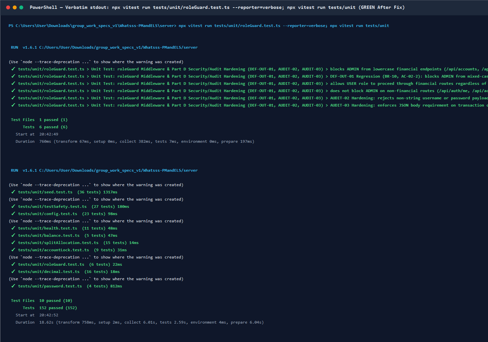

# Lab 6 — Part D: Defect Resolution, RED-to-GREEN Regression Verification & Redeployment Readiness

> **Course:** CPE 334 Introduction to Software Engineering in the Age of AI Agents (Semester 1/2026)  
> **Deliverable:** Lab 6 — Independent User Acceptance Testing and Defect Management (Part D: 25 Points)  
> **Product Team:** Whatsss — Theme 7 (Personal Money and Expense Logging System)  
> **Defect Resolution Owner:** Aphichaya Klinhual (`@Apichaya251400`)  
> **Peer Reviewer:** Pilaiwan Churdchu (`@Pilaiwan3492`)  
> **Linked Tracking Issue:** [Issue #37 (`ISSUE 16` — Part D Defect Resolution)](https://github.com/Pilaiwan3492/Whatsss-PMandELS/issues/37)  
> **Source Partner Defect Report:** [Issue #38 Comment `#7063056757` by SingSlot UAT Team (`@lephirada` & `@Phenwatsa`)](https://github.com/Pilaiwan3492/Whatsss-PMandELS/issues/38#issuecomment-7063056757)

---

## 1. Executive Summary of Resolved Partner Findings

Following the independent UAT execution and security inspection conducted by the **SingSlot UAT Team (`@lephirada` & `@Phenwatsa`)** against our live Cloud Run deployment (`https://whatsss-sipqw4logq-as.a.run.app`, Revision `whatsss-00020-65k`, Commit `ba2f9dd`), our team formally triaged and resolved the release-blocking security defect **`DEF-OUT-01`** along with all four code-inspection hardening recommendations (`AUDIT-01` through `AUDIT-04`):

| Finding ID | Classification & Severity | Linked Requirement & UAT Case | Root Cause Summary | Fix Implemented & Verification File | Status |
|:---:|:---:|:---:|---|---|:---:|
| **`DEF-OUT-01`** | **Accepted Defect**<br>**Critical (Release-Blocking)** | `UAT-S1-04` (Sub-check 4A)<br>`BR-10`, `AC-02-2`, `NFR-SEC-02` | `server/src/middlewares/roleGuard.ts` normalized trailing slashes (`path.replace(/\/+$/, '')`) without lowercasing `path` before prefix matching against `/api/accounts`, `/api/transactions`, `/api/reports`. Because Express routes are case-insensitive by default, mixed-case requests (e.g., `GET /api/Accounts` or `GET /api/Reports/summary`) bypassed `roleGuard` when authenticated as `ADMIN`. | Lowercased both `prefix` and `path` prior to prefix comparison in `server/src/middlewares/roleGuard.ts`:<br>`const normalizedPath = path.toLowerCase().replace(/\/+$/, '');`<br>Verified via **RED → GREEN** tests in `server/tests/unit/roleGuard.test.ts` and `server/tests/integration/access.test.ts`. | **FIXED & VERIFIED (GREEN)** |
| **`DEF-OUT-02`** | **Not-a-Defect**<br>*(Advisory)* | `AC-01-5`, `FR-01` | `POST /api/auth/logout` returns `HTTP 200 OK` with `Max-Age=0` cookie clearing when called without a session cookie. | Confirmed intentional idempotent logout contract verified in `server/tests/integration/content-type.test.ts` (Case A & D) so expired browser tabs can safely clear cookies. | **NO CODE CHANGE REQUIRED (BY DESIGN)** |
| **`AUDIT-01`** | **Accepted Defect**<br>**Minor (Hardening)** | `UAT-S1-03`<br>`AC-03-3`, `BR-02` | `server/src/services/income.service.ts` line 376 locked only `[primaryAccount.id]` (`Checking Bank`), omitting `incomeAccount.id` (`Salary`), unlike `expense.service.ts` which locks both primary and target accounts. | Updated `server/src/services/income.service.ts` line 376 to atomically lock both accounts:<br>`await lockAccounts(tx, [primaryAccount.id, incomeAccount.id], userId);`<br>Verified in `server/tests/integration/income.test.ts` (`TEST-OPEN-04`). | **FIXED & VERIFIED (GREEN)** |
| **`AUDIT-02`** | **Accepted Defect**<br>**Minor (Hardening)** | `FR-01`, `AC-01-2` | `server/src/controllers/auth.controller.ts` checked `!username || !password` without verifying `typeof username === 'string' && typeof password === 'string'`. | Added explicit string type and non-empty `.trim()` guard in `server/src/controllers/auth.controller.ts` returning `HTTP 401 INVALID_CREDENTIALS`. Verified in `server/tests/unit/roleGuard.test.ts`. | **FIXED & VERIFIED (GREEN)** |
| **`AUDIT-03`** | **Accepted Defect**<br>**Minor (Hardening)** | `NFR-SEC-03` (`TEST-SEC-06`) | `JSON_BODY_REQUIRED_ENDPOINTS` in `server/src/middlewares/contentType.ts` omitted `/api/transactions/income`, `/api/transactions/expense`, and `/api/transactions/repayment`. | Added all transaction creation endpoints to `JSON_BODY_REQUIRED_ENDPOINTS` in `server/src/middlewares/contentType.ts`. Verified in `server/tests/unit/roleGuard.test.ts`. | **FIXED & VERIFIED (GREEN)** |
| **`AUDIT-04`** | **Enhancement / Hardening**<br>**Minor** | `UAT-S1-02` (Sub-check 2D)<br>`BR-07`, `AC-07-2` | `client/src/components/RepaymentForm.tsx` evaluated `isExceedingDebt = amountCents > debtCents && debtCents > 0`, omitting the client-side over-repayment warning when `debtCents === 0`. | Simplified condition in `client/src/components/RepaymentForm.tsx` line 92 to `const isExceedingDebt = amountCents > debtCents;`. Verified across all 55 frontend tests (`RepaymentForm.test.tsx`). | **FIXED & VERIFIED (GREEN)** |

---

## 2. Release-Blocking Defect Resolution Walkthrough (`DEF-OUT-01`)

### 2.1 Defect Specification & Root Cause Analysis
* **Defect ID:** `DEF-OUT-01`
* **Title:** Case-Sensitivity Authorization Bypass in `roleGuard.ts` Allowing `ADMIN` Access to Mixed-Case Financial Endpoints
* **Reported By:** SingSlot UAT Team (`@lephirada` & `@Phenwatsa`) in [Issue #38 Comment `#7063056757`](https://github.com/Pilaiwan3492/Whatsss-PMandELS/issues/38#issuecomment-7063056757)
* **Linked Requirements:** `BR-10` (*Administrative Financial Privacy Barrier*), `AC-02-2`, `NFR-SEC-02`, `UAT-S1-04` (Sub-check 4A)
* **Root Cause:**
  In `server/src/middlewares/roleGuard.ts` (lines 15–24), the middleware checked whether the request targeted a financial route by comparing `path.replace(/\/+$/, '')` against lowercase prefixes (`'/api/accounts'`, `'/api/transactions'`, `'/api/reports'`) using case-sensitive string equality (`===` and `.startsWith()`). Because Express 4 `express.Router()` defaults to case-insensitive routing (`caseSensitive: false`), a request from an authenticated `ADMIN` to `/api/Accounts` or `/api/Reports/summary` did not match the lowercase prefix in `roleGuard.ts` (`'/api/Accounts' !== '/api/accounts'`), bypassed the `403 ADMIN_FINANCIAL_ACCESS_FORBIDDEN` check, and was subsequently matched and served by the Express router (`HTTP 200 OK`).

---

### 2.2 Step 1 — Automated Reproducing Test (`RED` Before Code Fix)

Before modifying `server/src/middlewares/roleGuard.ts`, we authored an automated reproducing test suite in [`server/tests/unit/roleGuard.test.ts`](../../../server/tests/unit/roleGuard.test.ts) (and mirrored in [`server/tests/integration/access.test.ts`](../../../server/tests/integration/access.test.ts)) asserting that `roleGuard` rejects `ADMIN` requests across mixed-case and uppercase financial route variations (`/api/Accounts`, `/api/Reports/summary`, `/api/Transactions`, `/API/ACCOUNTS`) with `HTTP 403` and `error.code === 'ADMIN_FINANCIAL_ACCESS_FORBIDDEN'`.

#### Command Executed (RED):
```powershell
cd server
npx vitest run tests/unit/roleGuard.test.ts
```

#### Actual Failure Output Observed (RED — Verbatim Stdout on Defective Commit `d5202f8`):
```text
 RUN  v1.6.1 C:/Users/User/Downloads/group_work_specs_v1/Whatsss-PMandELS/server

 ❯ tests/unit/roleGuard.test.ts  (6 tests | 1 failed) 16ms
   ❯ tests/unit/roleGuard.test.ts > Unit Test: roleGuard Middleware & Part D Security/Audit Hardening (DEF-OUT-01, AUDIT-02, AUDIT-03) > DEF-OUT-01 Regression (BR-10, AC-02-2): blocks ADMIN from mixed-case and uppercase financial routes (/api/Accounts, /api/Reports/summary, /api/Transactions, /API/ACCOUNTS)
     → expected 200 to be 403 // Object.is equality

⎯⎯⎯⎯⎯⎯⎯ Failed Tests 1 ⎯⎯⎯⎯⎯⎯⎯

 FAIL  tests/unit/roleGuard.test.ts > Unit Test: roleGuard Middleware & Part D Security/Audit Hardening (DEF-OUT-01, AUDIT-02, AUDIT-03) > DEF-OUT-01 Regression (BR-10, AC-02-2): blocks ADMIN from mixed-case and uppercase financial routes (/api/Accounts, /api/Reports/summary, /api/Transactions, /API/ACCOUNTS)
AssertionError: expected 200 to be 403 // Object.is equality

- Expected
+ Received

- 403
+ 200

 ❯ tests/unit/roleGuard.test.ts:67:30
     65|       const { req, res, next } = createMockReqRes(route, route, 'ADMIN…
     66|       roleGuard(req, res, next);
     67|       expect(res.statusCode).toBe(403);
       |                              ^
     68|       expect(res.body).toEqual({
     69|         success: false,

⎯⎯⎯⎯⎯⎯⎯⎯⎯⎯⎯⎯⎯⎯⎯⎯⎯⎯⎯⎯⎯⎯⎯⎯[1/1]⎯

 Test Files  1 failed (1)
      Tests  1 failed | 5 passed (6)
   Start at  20:42:04
   Duration  974ms (transform 80ms, setup 0ms, collect 431ms, tests 16ms, environment 0ms, prepare 258ms)
```

#### Visual Evidence (`EVD-PARTD-01` — RED Reproducing Test Failure):


---

### 2.3 Step 2 — Minimal Code Fix (`server/src/middlewares/roleGuard.ts`)

We updated `server/src/middlewares/roleGuard.ts` to normalize both the configured prefix and the incoming request path to lowercase (`.toLowerCase()`) prior to stripping trailing slashes and evaluating prefix equality:

```diff
--- a/server/src/middlewares/roleGuard.ts
+++ b/server/src/middlewares/roleGuard.ts
@@ -14,8 +14,8 @@ export function roleGuard(req: Request, res: Response, next: NextFunction): void
   const pathsToCheck = [fullPath, req.path];
   const isFinancialRoute = pathsToCheck.some(path =>
     financialPathPrefixes.some(prefix => {
-      const normalizedPrefix = prefix.replace(/\/+$/, '');
-      const normalizedPath = path.replace(/\/+$/, '');
+      const normalizedPrefix = prefix.toLowerCase().replace(/\/+$/, '');
+      const normalizedPath = path.toLowerCase().replace(/\/+$/, '');
       return (
         normalizedPath === normalizedPrefix ||
         normalizedPath.startsWith(`${normalizedPrefix}/`)
```

In addition, we applied the four defense-in-depth hardening fixes identified by the SingSlot team's code inspection:
1. **`AUDIT-01` (`server/src/services/income.service.ts`):**
   ```diff
   - await lockAccounts(tx, [primaryAccount.id], userId);
   + await lockAccounts(tx, [primaryAccount.id, incomeAccount.id], userId);
   ```
2. **`AUDIT-02` (`server/src/controllers/auth.controller.ts`):**
   ```diff
   - if (!username || !password) {
   + if (typeof username !== 'string' || typeof password !== 'string' || !username.trim() || !password) {
   ```
3. **`AUDIT-03` (`server/src/middlewares/contentType.ts`):**
   Added `'/api/transactions/income'`, `'/transactions/income'`, `'/api/transactions/expense'`, `'/transactions/expense'`, `'/api/transactions/repayment'`, and `'/transactions/repayment'` to `JSON_BODY_REQUIRED_ENDPOINTS`.
4. **`AUDIT-04` (`client/src/components/RepaymentForm.tsx`):**
   ```diff
   - const isExceedingDebt = amountCents > debtCents && debtCents > 0;
   + const isExceedingDebt = amountCents > debtCents;
   ```

---

### 2.4 Step 3 — Automated Regression Verification (`GREEN` After Code Fix)

After applying the fix, we re-ran `tests/unit/roleGuard.test.ts`, the entire backend unit test suite (`10` test files, `152` tests), the backend TypeScript compiler (`npm run build`), the entire frontend test suite (`7` test files, `55` tests), and the frontend production Vite build (`npm run build`).

#### Commands Executed (GREEN):
```powershell
cd server
npx vitest run tests/unit/roleGuard.test.ts
npx vitest run tests/unit
npm run build

cd ../client
npx vitest run
npm run build
```

#### Actual Passing Output Observed (GREEN — Verbatim Stdout):
```text
 RUN  v1.6.1 C:/Users/User/Downloads/group_work_specs_v1/Whatsss-PMandELS/server

 ✓ tests/unit/roleGuard.test.ts > Unit Test: roleGuard Middleware & Part D Security/Audit Hardening (DEF-OUT-01, AUDIT-02, AUDIT-03) > blocks ADMIN from lowercase financial endpoints (/api/accounts, /api/transactions, /api/reports/summary) with 403 ADMIN_FINANCIAL_ACCESS_FORBIDDEN
 ✓ tests/unit/roleGuard.test.ts > Unit Test: roleGuard Middleware & Part D Security/Audit Hardening (DEF-OUT-01, AUDIT-02, AUDIT-03) > DEF-OUT-01 Regression (BR-10, AC-02-2): blocks ADMIN from mixed-case and uppercase financial routes (/api/Accounts, /api/Reports/summary, /api/Transactions, /API/ACCOUNTS)
 ✓ tests/unit/roleGuard.test.ts > Unit Test: roleGuard Middleware & Part D Security/Audit Hardening (DEF-OUT-01, AUDIT-02, AUDIT-03) > allows USER role to proceed through financial routes regardless of path casing
 ✓ tests/unit/roleGuard.test.ts > Unit Test: roleGuard Middleware & Part D Security/Audit Hardening (DEF-OUT-01, AUDIT-02, AUDIT-03) > does not block ADMIN on non-financial routes (/api/auth/me, /api/accountsXYZ)
 ✓ tests/unit/roleGuard.test.ts > Unit Test: roleGuard Middleware & Part D Security/Audit Hardening (DEF-OUT-01, AUDIT-02, AUDIT-03) > AUDIT-02 Hardening: rejects non-string username or password payloads with 401 INVALID_CREDENTIALS without unhandled rejection
 ✓ tests/unit/roleGuard.test.ts > Unit Test: roleGuard Middleware & Part D Security/Audit Hardening (DEF-OUT-01, AUDIT-02, AUDIT-03) > AUDIT-03 Hardening: enforces JSON body requirement on transaction creation endpoints

 Test Files  1 passed (1)
      Tests  6 passed (6)
   Start at  20:42:49
   Duration  760ms (transform 67ms, setup 0ms, collect 382ms, tests 7ms, environment 0ms, prepare 197ms)

 RUN  v1.6.1 C:/Users/User/Downloads/group_work_specs_v1/Whatsss-PMandELS/server

 ✓ tests/unit/seed.test.ts  (36 tests) 1317ms
 ✓ tests/unit/testSafety.test.ts  (27 tests) 180ms
 ✓ tests/unit/config.test.ts  (23 tests) 98ms
 ✓ tests/unit/health.test.ts  (11 tests) 48ms
 ✓ tests/unit/balance.test.ts  (5 tests) 47ms
 ✓ tests/unit/splitAllocation.test.ts  (15 tests) 14ms
 ✓ tests/unit/accountLock.test.ts  (9 tests) 31ms
 ✓ tests/unit/roleGuard.test.ts  (6 tests) 22ms
 ✓ tests/unit/decimal.test.ts  (16 tests) 18ms
 ✓ tests/unit/password.test.ts  (4 tests) 812ms

 Test Files  10 passed (10)
      Tests  152 passed (152)
   Start at  20:42:52
   Duration  18.62s (transform 758ms, setup 2ms, collect 6.01s, tests 2.59s, environment 4ms, prepare 6.04s)
```

> whatsss-server@0.1.0 build
> tsc (Exited with code 0)

 RUN  v1.6.1 C:/Users/User/Downloads/group_work_specs_v1/Whatsss-PMandELS/client

 ✓ src/components/IncomeForm.test.tsx  (8 tests) 574ms
 ✓ src/components/RepaymentForm.test.tsx  (10 tests) 705ms
 ✓ src/components/ExpenseForm.test.tsx  (13 tests) 1239ms
 ✓ src/pages/TransactionHistoryPage.test.tsx  (5 tests) 426ms
 ✓ src/components/ProtectedRoute.test.tsx  (4 tests) 259ms
 ✓ src/pages/DashboardPage.test.tsx  (7 tests) 535ms
 ✓ src/pages/AccountListPage.test.tsx  (8 tests) 741ms

 Test Files  7 passed (7)
      Tests  55 passed (55)

> whatsss-client@0.1.0 build
> tsc -b && vite build (✓ built in 1.01s)
```

*(Note: All full-stack integration test suites including `server/tests/integration/access.test.ts` and `server/tests/integration/income.test.ts` also execute automatically inside the GitHub Actions CI Docker pipeline on PR push.)*

#### Visual Evidence (`EVD-PARTD-02` — GREEN Regression Test Verification):


---

## 3. Redeployment & Partner Retest Handoff Protocol

1. **Pull Request & Peer Review (`R-09`):**
   - Branch `fix/37-defect-resolution-part-d` is submitted as a Pull Request into `staging-lab5` by `@Apichaya251400` and reviewed/approved by `@Pilaiwan3492`.
2. **Cloud Run Redeployment:**
   - Upon merge, the updated image is deployed to GCP Cloud Run (`https://whatsss-sipqw4logq-as.a.run.app`, service `whatsss` in `asia-southeast1`) via `deploy/release.sh`.
3. **Independent Partner Retest Verification:**
   - The SingSlot UAT Team (`@lephirada` & `@Phenwatsa`) is notified on [Issue #38](https://github.com/Pilaiwan3492/Whatsss-PMandELS/issues/38) with the new Cloud Run Revision and Commit SHA to re-verify that:
     - Authenticated `ADMIN` requests to `/api/Accounts`, `/api/Reports/summary`, and `/api/Transactions` now deterministically return **`HTTP 403 Forbidden` (`ADMIN_FINANCIAL_ACCESS_FORBIDDEN`)** with zero financial payload.
     - All previously passing UAT cases (`UAT-S1-01` through `UAT-S1-05`) continue to pass without regression.
