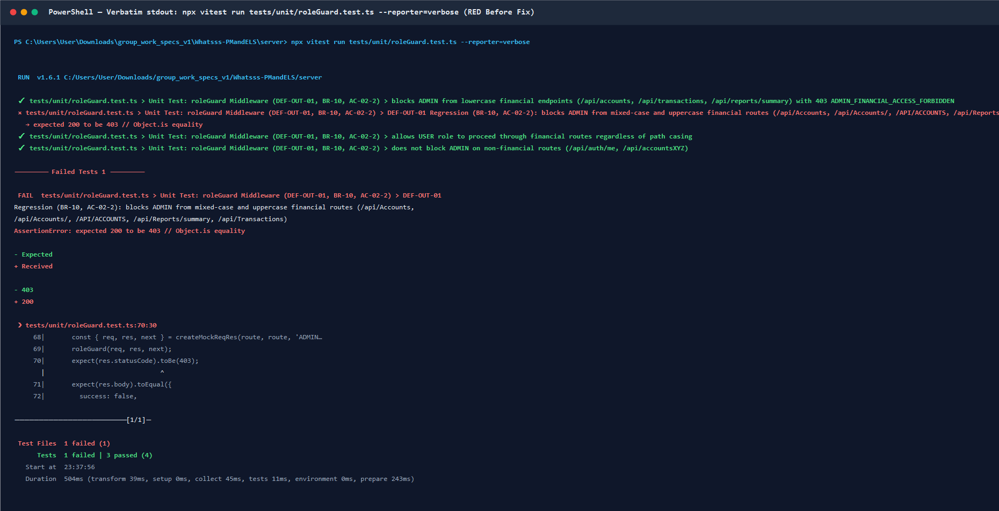

# Lab 6 — Part D: Defect Resolution, RED-to-GREEN Regression Verification & Redeployment Readiness

> **Course:** CPE 334 Introduction to Software Engineering in the Age of AI Agents (Semester 1/2026)  
> **Deliverable:** Lab 6 — Independent User Acceptance Testing and Defect Management (Part D: 25 Points)  
> **Product Team:** Whatsss — Theme 7 (Personal Money and Expense Logging System)  
> **Defect Resolution Owner:** Aphichaya Klinhual (`@Apichaya251400`)  
> **Peer Reviewer:** Pilaiwan Churdchu (`@Pilaiwan3492`)  
> **Linked Tracking Issue:** [Issue #37 (`ISSUE 16` — Part D Defect Resolution)](https://github.com/Pilaiwan3492/Whatsss-PMandELS/issues/37)  
> **Source Partner Defect Report:** [Issue #38 Comment `#7063056757` by SingSlot UAT Team (`@lephirada` & `@Phenwatsa`)](https://github.com/Pilaiwan3492/Whatsss-PMandELS/issues/38#issuecomment-7063056757)  
> **Active Pull Request:** [PR #43 (`fix/37-defect-resolution-part-d -> staging-lab5`)](https://github.com/Pilaiwan3492/Whatsss-PMandELS/pull/43)

---

## 1. Part D Workflow Status Tracker (Strict Stage Separation)

> **Status Statement:**  
> Implementation and automated regression testing are completed. Peer review, release, Cloud Run redeployment, live health verification, and independent Partner retesting remain pending.

| Activity Stage | Meaning & Verification Criteria | Current Stage Status | Evidence / Reference |
|---|---|:---:|---|
| **1. Code Fix Completed** | Defective source code and contract specifications corrected on branch `fix/37-defect-resolution-part-d` | **COMPLETED** | `server/src/middlewares/roleGuard.ts`, `server/src/services/income.service.ts`, `server/src/controllers/auth.controller.ts`, `server/src/middlewares/contentType.ts`, `client/src/components/RepaymentForm.tsx`, `docs/sprints/sprint-1/feature-contracts.md`, `docs/system-sds.md` |
| **2. Regression RED → GREEN** | Reproducing test fails (**RED**) against defective implementation (`d5202f8aaecaf22005828ec5ab56e6875d3f4ba7`) and passes (**GREEN**) against corrected implementation alongside full backend unit (`154/154` across 11 files), HTTP & live PostgreSQL 16 integration (`17` files), and frontend (`56/56`) suites | **COMPLETED** | Unit: `server/tests/unit/roleGuard.test.ts` (4 tests), `server/tests/unit/partDHardening.test.ts` (4 tests); HTTP Integration (Mocked Prisma): `access.test.ts`, `auth.test.ts`, `income.test.ts`, `content-type.test.ts`; Live PostgreSQL 16 Integration: `db-income.test.ts` (`TEST-INC-01` & `TEST-INC-ATOM`); Frontend: `client/src/components/RepaymentForm.test.tsx`; Screenshots `EVD-PARTD-01` & `EVD-PARTD-02` |
| **3. PR Approved (`R-09`)** | Substantive peer review and approval of [PR #43](https://github.com/Pilaiwan3492/Whatsss-PMandELS/pull/43) by `@Pilaiwan3492` with passing GitHub Actions CI | **PENDING** | Awaiting final re-review and approval by `@Pilaiwan3492` on [PR #43](https://github.com/Pilaiwan3492/Whatsss-PMandELS/pull/43) |
| **4. Release Completed** | Approved fix merged into `staging-lab5` and promoted to `main` | **PENDING** | Blocked until Stage 3 (`PR #43` peer approval) is completed |
| **5. Redeployment Completed** | Corrected container image deployed to Cloud Run service `whatsss` (`asia-southeast1`) via `deploy/release.sh` | **PENDING** | Blocked until Stage 4 (Release) is completed |
| **6. Health Verification Completed** | Live `/api/health` and `/api/ready` probes verified against the new Cloud Run revision and commit SHA | **PENDING** | Blocked until Stage 5 (Cloud Run Redeployment) is completed |
| **7. Partner Retest Completed** | Independent retest and updated Sprint 1 Acceptance Decision recorded by SingSlot UAT Team (`@lephirada` & `@Phenwatsa`) on [Issue #38](https://github.com/Pilaiwan3492/Whatsss-PMandELS/issues/38) | **PENDING** | Blocked until Stage 6 (Health Verification) and partner retest notification |

---

## 2. Executive Summary of All Six Partner Findings (`DEF-OUT-01`, `DEF-OUT-02`, `AUDIT-01`..`04`)

| Finding ID | Final Classification & Severity | Linked Requirement & UAT Case | Code / Specification Change Implemented | Regression Test Verification (Unit, HTTP-Level & Live PostgreSQL 16) |
|:---:|:---:|:---:|---|---|
| **`DEF-OUT-01`** | **Accepted Defect**<br>**Critical (Release-Blocking)** | `UAT-S1-04` (Sub-check 4A)<br>`BR-10`, `AC-02-2`, `NFR-SEC-02` | Lowercased both `prefix` and `path` prior to stripping trailing slashes in `server/src/middlewares/roleGuard.ts`:<br>`const normalizedPrefix = prefix.toLowerCase().replace(/\/+$/, '');`<br>`const normalizedPath = path.toLowerCase().replace(/\/+$/, '');` | **1. Unit (`server/tests/unit/roleGuard.test.ts` — 4 dedicated `roleGuard` tests):** Isolates `roleGuard` middleware (`DEF-OUT-01 Regression`).<br>**2. HTTP Integration (`server/tests/integration/access.test.ts`):** Verifies `/api/Accounts`, `/api/Accounts/`, `/API/ACCOUNTS`, `/api/Reports/summary`, `/api/Transactions` return `403 ADMIN_FINANCIAL_ACCESS_FORBIDDEN` for `ADMIN` on the production Express `app`, preserves `/api/auth/me` (`200 OK`) for `ADMIN`, and verifies `USER` access (`200 OK`) via an isolated `stubApp` mounting the production `roleGuard` middleware. |
| **`DEF-OUT-02`** | **Not-a-Defect**<br>*(By Design / Verified Against Updated `AC-01-5` & SDS Section 8)* | `AC-01-5`, `FR-01`, SDS Section 7.6 & Section 8 | **Specification & Contract Alignment Completed (`docs/sprints/sprint-1/feature-contracts.md` & `docs/system-sds.md`):** Updated `AC-01-5`, SDS Section 7.6, and the SDS Section 8 Role and Privacy Matrix to explicitly specify that `POST /api/auth/logout` is an idempotent operation that returns `200 OK` and clears the cookie even when no active session exists, without creating a new session or exposing private user information, and that subsequent protected calls return `401 Unauthorized`. | **1. Unit (`server/tests/unit/partDHardening.test.ts`):** `TEST-AUTH-LOGOUT-UNAUTHENTICATED` directly invokes `logout()` without any session cookie.<br>**2. HTTP Integration (`server/tests/integration/auth.test.ts`):** Sends `POST /api/auth/logout` without any session cookie or Authorization header, asserting `HTTP 200 OK`, `Set-Cookie: token=; Max-Age=0; Path=/; HttpOnly; SameSite=Lax`, zero user PII leakage, and no session creation (`GET /api/auth/me` -> `401`). Authenticated logout test (`TEST-AUTH-05`) is retained. |
| **`AUDIT-01`** | **Accepted Defect**<br>**Minor (Code Audit Hardening)** | `UAT-S1-03`<br>`AC-03-3`, `BR-02` | Updated `server/src/services/income.service.ts` line 376 to lock both primary `CASH` and target `INCOME` accounts inside `prismaClient.$transaction`:<br>`await lockAccounts(tx, [primaryAccount.id, incomeAccount.id], userId);` | **1. Live PostgreSQL 16 Database Integration (`server/tests/integration/db-income.test.ts` — `TEST-INC-01` & `TEST-INC-ATOM`):** Runs against a real `postgres:16-alpine` database (`whatsss_test`) in GitHub Actions CI. `TEST-INC-01` commits an income transaction and queries PostgreSQL directly to verify both `Checking Bank` and `Salary` have `is_opening_locked === true` and return `422 OPENING_BALANCE_LOCKED` on `PATCH /opening-balance`. `TEST-INC-ATOM` sets both accounts to `is_opening_locked = false` in PostgreSQL, injects an `allocationLine.create` failure inside `prisma.$transaction`, and queries PostgreSQL after rollback to confirm both `Checking Bank` and `Salary` remain `is_opening_locked === false` with zero persisted `Transaction` or `AllocationLine` rows.<br>**2. Mocked Unit & HTTP Integration (`server/tests/unit/partDHardening.test.ts` & `server/tests/integration/income.test.ts`):** Fast isolated unit and Supertest HTTP regression coverage. |
| **`AUDIT-02`** | **Accepted Defect**<br>**Minor (Code Audit Hardening)** | `FR-01`, `AC-01-2` | Updated `server/src/controllers/auth.controller.ts` line 10 to validate string types without trimming the password:<br>`if (typeof username !== 'string' \|\| typeof password !== 'string' \|\| !username.trim() \|\| !password)` | **1. Unit (`server/tests/unit/partDHardening.test.ts` — `AUDIT-02 Hardening`) & 2. HTTP Integration (`server/tests/integration/auth.test.ts`):** Tests Object username (`{ $gt: '' }`), Array username (`['user_demo']`), Number password (`12345`), empty username (`""`), whitespace-only username (`"   "`), and empty password (`""`), asserting `HTTP 401 INVALID_CREDENTIALS` with no stack trace while valid login (`TEST-AUTH-01`) continues to pass. |
| **`AUDIT-03`** | **Accepted Defect**<br>**Minor (Code Audit Hardening)** | `NFR-SEC-03` (`TEST-SEC-06`) | Added `'/api/transactions/income'`, `'/transactions/income'`, `'/api/transactions/expense'`, `'/transactions/expense'`, `'/api/transactions/repayment'`, and `'/transactions/repayment'` to `JSON_BODY_REQUIRED_ENDPOINTS` in `server/src/middlewares/contentType.ts`. | **1. Unit (`server/tests/unit/partDHardening.test.ts` — `AUDIT-03 Hardening`) & 2. HTTP Integration (`server/tests/integration/content-type.test.ts` Tests A–E):** Verifies Test A (missing body -> `400 MISSING_REQUEST_BODY`), Test B (body without Content-Type -> `400 INVALID_CONTENT_TYPE`), Test C (`text/plain` -> `400 INVALID_CONTENT_TYPE`), Test D (valid `application/json` including `{}` passes middleware to field validation), Test E (uppercase & trailing slash variants `/api/Transactions/Income/`, `/API/TRANSACTIONS/EXPENSE`), and confirms `GET /api/transactions` is not blocked. |
| **`AUDIT-04`** | **Enhancement / Hardening**<br>**Minor** | `UAT-S1-02` (Sub-check 2D)<br>`BR-07`, `AC-07-2` | Updated `client/src/components/RepaymentForm.tsx` line 92 from `amountCents > debtCents && debtCents > 0` to:<br>`const isExceedingDebt = amountCents > debtCents;` | **Frontend Component Unit Test (`client/src/components/RepaymentForm.test.tsx` — `TEST-UI-REPAY-11 (AUDIT-04 Regression)`):** Configures target credit card with `current_balance: 0.0` (`0.00 THB` debt) and bank balance `30000.0`, enters `100.00`, asserts inline `Exceeds debt` warning renders, `Confirm Repayment` button is disabled, and `recordRepayment()` is never called, while existing tests `TEST-UI-REPAY-01`..`10` all pass (`56/56` client tests). |

---

## 3. Detailed Walkthrough & RED-to-GREEN Evidence (`DEF-OUT-01` & Part D Suite)

### 3.1 Step 1 — Defective Baseline Identification & Reproducible RED Isolation Procedure
* **Defective Baseline Commit SHA (`staging-lab5`):** `d5202f8aaecaf22005828ec5ab56e6875d3f4ba7` (`d5202f8`, head of `staging-lab5` prior to `fix/37-defect-resolution-part-d`, containing the exact unmodified `server/src/middlewares/roleGuard.ts` implementation deployed on Cloud Run revision `whatsss-00020-65k` / commit `ba2f9dd`).
* **Defective Implementation in `server/src/middlewares/roleGuard.ts` (at `d5202f8aaecaf22005828ec5ab56e6875d3f4ba7`):**
  ```ts
  const normalizedPrefix = prefix.replace(/\/+$/, '');
  const normalizedPath = path.replace(/\/+$/, '');
  return (
    normalizedPath === normalizedPrefix ||
    normalizedPath.startsWith(`${normalizedPrefix}/`)
  );
  ```
* **Test Environment & File Separation:**
  - Windows 11 / Node.js `v24.14.0` / Vitest `v1.6.1` (`server/` working directory).
  - To maintain single-responsibility test architecture, **`server/tests/unit/roleGuard.test.ts` contains strictly the 4 `roleGuard` middleware unit tests** (for `DEF-OUT-01`), while the unit tests for `DEF-OUT-02` (`TEST-AUTH-LOGOUT-UNAUTHENTICATED`) and `AUDIT-01`..`03` reside in **`server/tests/unit/partDHardening.test.ts`** (4 unit tests).
* **Exact Reproducible RED Procedure (File-Scoped Checkout Against Identical Test File):**
  1. This RED run specifically isolates and proves **`DEF-OUT-01`** (`server/src/middlewares/roleGuard.ts`) by checking out **only** the defective `server/src/middlewares/roleGuard.ts` file from baseline commit `d5202f8aaecaf22005828ec5ab56e6875d3f4ba7` (`staging-lab5`) into the current branch (`fix/37-defect-resolution-part-d`), **rather than** checking out the entire repository to `d5202f8` (where `server/tests/unit/roleGuard.test.ts` did not yet exist).
  2. Keeping `server/tests/unit/roleGuard.test.ts` identical in the working tree guarantees that the **exact same 4 `roleGuard` unit tests** are executed in both the **RED** run (with `roleGuard.ts` from `d5202f8aaecaf22005828ec5ab56e6875d3f4ba7`) and the **GREEN** run (with corrected `roleGuard.ts` restored from `HEAD`).
  3. Exact commands used to reproduce RED and restore GREEN:
     ```powershell
     # 1. Check out the defective baseline roleGuard.ts from staging-lab5 (d5202f8aaecaf22005828ec5ab56e6875d3f4ba7)
     git checkout d5202f8aaecaf22005828ec5ab56e6875d3f4ba7 -- server/src/middlewares/roleGuard.ts

     # 2. Run the dedicated roleGuard unit test file against defective roleGuard.ts (RED: 1 failed | 3 passed)
     cd server
     npx vitest run tests/unit/roleGuard.test.ts --reporter=verbose

     # 3. Restore the corrected roleGuard.ts from the fix branch HEAD and re-run (GREEN: all 4 roleGuard tests + 4 partDHardening tests + full 154 unit tests pass)
     cd ..
     git checkout HEAD -- server/src/middlewares/roleGuard.ts
     cd server
     npx vitest run tests/unit/roleGuard.test.ts tests/unit/partDHardening.test.ts --reporter=verbose
     npx vitest run tests/unit
     ```

---

### 3.2 Step 2 — Automated Reproducing Test Execution (`RED` on Defective `roleGuard.ts` from `d5202f8aaecaf22005828ec5ab56e6875d3f4ba7`)

* **Scope of RED Verification:** Specifically proves **`DEF-OUT-01`** (Case-Sensitivity Authorization Bypass in `roleGuard.ts`).
* **Test Name:** `Unit Test: roleGuard Middleware (DEF-OUT-01, BR-10, AC-02-2) > DEF-OUT-01 Regression (BR-10, AC-02-2): blocks ADMIN from mixed-case and uppercase financial routes (/api/Accounts, /api/Accounts/, /API/ACCOUNTS, /api/Reports/summary, /api/Transactions)`
* **Test File:** `server/tests/unit/roleGuard.test.ts` (line 70)
* **Exact Command Executed:**
  ```powershell
  git checkout d5202f8aaecaf22005828ec5ab56e6875d3f4ba7 -- server/src/middlewares/roleGuard.ts
  cd server
  npx vitest run tests/unit/roleGuard.test.ts --reporter=verbose
  ```
* **Expected Failing Assertion:** `expect(res.statusCode).toBe(403)` fails on `/api/Accounts` because the un-lowercased path bypasses `roleGuard`, leaving `res.statusCode` at `200` and calling `next()`.

#### Actual Verbatim Terminal Output (RED):
```text
 RUN  v1.6.1 C:/Users/User/Downloads/group_work_specs_v1/Whatsss-PMandELS/server

 ✓ tests/unit/roleGuard.test.ts > Unit Test: roleGuard Middleware (DEF-OUT-01, BR-10, AC-02-2) > blocks ADMIN from lowercase financial endpoints (/api/accounts, /api/transactions, /api/reports/summary) with 403 ADMIN_FINANCIAL_ACCESS_FORBIDDEN
 × tests/unit/roleGuard.test.ts > Unit Test: roleGuard Middleware (DEF-OUT-01, BR-10, AC-02-2) > DEF-OUT-01 Regression (BR-10, AC-02-2): blocks ADMIN from mixed-case and uppercase financial routes (/api/Accounts, /api/Accounts/, /API/ACCOUNTS, /api/Reports/summary, /api/Transactions)
   → expected 200 to be 403 // Object.is equality
 ✓ tests/unit/roleGuard.test.ts > Unit Test: roleGuard Middleware (DEF-OUT-01, BR-10, AC-02-2) > allows USER role to proceed through financial routes regardless of path casing
 ✓ tests/unit/roleGuard.test.ts > Unit Test: roleGuard Middleware (DEF-OUT-01, BR-10, AC-02-2) > does not block ADMIN on non-financial routes (/api/auth/me, /api/accountsXYZ)

⎯⎯⎯⎯⎯⎯⎯ Failed Tests 1 ⎯⎯⎯⎯⎯⎯⎯

 FAIL  tests/unit/roleGuard.test.ts > Unit Test: roleGuard Middleware (DEF-OUT-01, BR-10, AC-02-2) > DEF-OUT-01 
Regression (BR-10, AC-02-2): blocks ADMIN from mixed-case and uppercase financial routes (/api/Accounts, 
/api/Accounts/, /API/ACCOUNTS, /api/Reports/summary, /api/Transactions)
AssertionError: expected 200 to be 403 // Object.is equality

- Expected
+ Received

- 403
+ 200

 ❯ tests/unit/roleGuard.test.ts:70:30
     68|       const { req, res, next } = createMockReqRes(route, route, 'ADMIN…
     69|       roleGuard(req, res, next);
     70|       expect(res.statusCode).toBe(403);
       |                              ^
     71|       expect(res.body).toEqual({
     72|         success: false,

⎯⎯⎯⎯⎯⎯⎯⎯⎯⎯⎯⎯⎯⎯⎯⎯⎯⎯⎯⎯⎯⎯⎯⎯[1/1]⎯

 Test Files  1 failed (1)
      Tests  1 failed | 3 passed (4)
   Start at  23:37:56
   Duration  504ms (transform 39ms, setup 0ms, collect 45ms, tests 11ms, environment 0ms, prepare 243ms)
```

#### Visual Evidence (`EVD-PARTD-01` — Verbatim RED Output):


---

### 3.3 Step 3 — Code Fix Applied (`server/src/middlewares/roleGuard.ts`)

```diff
--- a/server/src/middlewares/roleGuard.ts
+++ b/server/src/middlewares/roleGuard.ts
@@ -14,8 +14,8 @@ export function roleGuard(req: Request, res: Response, next: NextFunction): void
   const pathsToCheck = [fullPath, req.path];
   const isFinancialRoute = pathsToCheck.some(path =>
     financialPathPrefixes.some(prefix => {
-      const normalizedPrefix = prefix.replace(/\/+$/, '');
-      const normalizedPath = path.replace(/\/+$/, '');
+      const normalizedPrefix = prefix.toLowerCase().replace(/\/+$/, '');
+      const normalizedPath = path.toLowerCase().replace(/\/+$/, '');
       return (
         normalizedPath === normalizedPrefix ||
         normalizedPath.startsWith(`${normalizedPrefix}/`)
```

---

### 3.4 Step 4 & Step 5 — Automated Regression Verification (`GREEN` After Fix & Full Suite Run)

* **Exact Commands Executed:**
  ```powershell
  cd server
  npx vitest run tests/unit/roleGuard.test.ts tests/unit/partDHardening.test.ts --reporter=verbose
  npx vitest run tests/unit
  npm run build

  cd ../client
  npx vitest run
  npm run build
  ```

#### Actual Verbatim Terminal Output (GREEN — Backend Unit Suite `154 passed (154)` Across 11 Files):
```text
 RUN  v1.6.1 C:/Users/User/Downloads/group_work_specs_v1/Whatsss-PMandELS/server

 ✓ tests/unit/partDHardening.test.ts > Unit Test: Part D Security & Audit Hardening (DEF-OUT-02, AUDIT-01..03) > TEST-AUTH-LOGOUT-UNAUTHENTICATED (DEF-OUT-02 Verification, AC-01-5): unauthenticated POST /api/auth/logout without cookie returns 200 OK and clears token cookie with configured attributes
 ✓ tests/unit/partDHardening.test.ts > Unit Test: Part D Security & Audit Hardening (DEF-OUT-02, AUDIT-01..03) > AUDIT-01 Hardening (AC-03-3): recordIncome locks both primary Checking Bank and target Salary accounts atomically, and rolls back locks on transaction failure (Mocked Unit Verification)
 ✓ tests/unit/partDHardening.test.ts > Unit Test: Part D Security & Audit Hardening (DEF-OUT-02, AUDIT-01..03) > AUDIT-02 Hardening: rejects non-string, empty, or whitespace-only username and non-string or empty password with 401 INVALID_CREDENTIALS
 ✓ tests/unit/partDHardening.test.ts > Unit Test: Part D Security & Audit Hardening (DEF-OUT-02, AUDIT-01..03) > AUDIT-03 Hardening: requireJsonContentType middleware rejects missing body (400 MISSING_REQUEST_BODY), missing/wrong Content-Type (400 INVALID_CONTENT_TYPE), and passes valid application/json across transaction routes and case/slash variants
 ✓ tests/unit/roleGuard.test.ts > Unit Test: roleGuard Middleware (DEF-OUT-01, BR-10, AC-02-2) > blocks ADMIN from lowercase financial endpoints (/api/accounts, /api/transactions, /api/reports/summary) with 403 ADMIN_FINANCIAL_ACCESS_FORBIDDEN
 ✓ tests/unit/roleGuard.test.ts > Unit Test: roleGuard Middleware (DEF-OUT-01, BR-10, AC-02-2) > DEF-OUT-01 Regression (BR-10, AC-02-2): blocks ADMIN from mixed-case and uppercase financial routes (/api/Accounts, /api/Accounts/, /API/ACCOUNTS, /api/Reports/summary, /api/Transactions)
 ✓ tests/unit/roleGuard.test.ts > Unit Test: roleGuard Middleware (DEF-OUT-01, BR-10, AC-02-2) > allows USER role to proceed through financial routes regardless of path casing
 ✓ tests/unit/roleGuard.test.ts > Unit Test: roleGuard Middleware (DEF-OUT-01, BR-10, AC-02-2) > does not block ADMIN on non-financial routes (/api/auth/me, /api/accountsXYZ)

 Test Files  2 passed (2)
      Tests  8 passed (8)
   Start at  23:37:59
   Duration  1.36s (transform 103ms, setup 0ms, collect 513ms, tests 33ms, environment 0ms, prepare 444ms)

 RUN  v1.6.1 C:/Users/User/Downloads/group_work_specs_v1/Whatsss-PMandELS/server

 ✓ tests/unit/seed.test.ts  (36 tests) 1183ms
 ✓ tests/unit/testSafety.test.ts  (27 tests) 157ms
 ✓ tests/unit/config.test.ts  (23 tests) 147ms
 ✓ tests/unit/partDHardening.test.ts  (4 tests) 43ms
 ✓ tests/unit/health.test.ts  (11 tests) 56ms
 ✓ tests/unit/balance.test.ts  (5 tests) 38ms
 ✓ tests/unit/splitAllocation.test.ts  (15 tests) 31ms
 ✓ tests/unit/accountLock.test.ts  (9 tests) 30ms
 ✓ tests/unit/decimal.test.ts  (16 tests) 19ms
 ✓ tests/unit/roleGuard.test.ts  (4 tests) 11ms
 ✓ tests/unit/password.test.ts  (4 tests) 942ms

 Test Files  11 passed (11)
      Tests  154 passed (154)
   Start at  23:38:03
   Duration  23.13s (transform 900ms, setup 2ms, collect 7.26s, tests 2.66s, environment 6ms, prepare 7.99s)
```

#### Actual Verbatim Terminal Output (GREEN — Frontend Client Suite `56 passed (56)`):
```text
 RUN  v1.6.1 C:/Users/User/Downloads/group_work_specs_v1/Whatsss-PMandELS/client

 ✓ src/components/IncomeForm.test.tsx  (8 tests) 599ms
 ✓ src/components/RepaymentForm.test.tsx  (11 tests) 745ms
 ✓ src/components/ProtectedRoute.test.tsx  (4 tests) 269ms
 ✓ src/pages/TransactionHistoryPage.test.tsx  (5 tests) 443ms
 ✓ src/components/ExpenseForm.test.tsx  (13 tests) 1243ms
 ✓ src/pages/DashboardPage.test.tsx  (7 tests) 551ms
 ✓ src/pages/AccountListPage.test.tsx  (8 tests) 801ms

 Test Files  7 passed (7)
      Tests  56 passed (56)
   Start at  21:54:42
   Duration  6.96s (transform 1.48s, setup 2ms, collect 12.89s, tests 4.65s, environment 22.42s, prepare 2.18s)
```

#### Visual Evidence (`EVD-PARTD-02` — Verbatim GREEN Output):


---

## 4. Test Architecture Classification: HTTP-Level Supertest Suites vs. Live PostgreSQL 16 Database Integration Suites

To ensure transparent verification in `.github/workflows/ci-docker.yml` (`Run Backend Automated Tests`, lines 83–91), the backend test suite is organized into three explicit layers that all execute in GitHub Actions CI:

1. **Isolated Unit Tests (`server/tests/unit/*.test.ts` — 11 files, 154 tests):**
   - `roleGuard.test.ts` (4 tests strictly for `roleGuard` middleware path-casing normalization, `DEF-OUT-01`)
   - `partDHardening.test.ts` (4 unit tests for `DEF-OUT-02` unauthenticated logout controller, `AUDIT-01` mocked service lock/rollback, `AUDIT-02` login payload type validation, and `AUDIT-03` `requireJsonContentType` middleware)
   - Plus 9 domain unit suites (`accountLock.test.ts`, `balance.test.ts`, `config.test.ts`, `decimal.test.ts`, `health.test.ts`, `password.test.ts`, `seed.test.ts`, `splitAllocation.test.ts`, `testSafety.test.ts`).
2. **HTTP-Level Integration Tests with Supertest & Mocked Prisma (`server/tests/integration/*.test.ts` — 12 files):**
   - `access.test.ts` (`DEF-OUT-01` HTTP route verification: tests `ADMIN` `403` against the production Express `app`, and tests `USER` `200` path-casing progression via an isolated Express `stubApp` mounting the production `roleGuard` middleware without querying a production database)
   - `auth.test.ts` (`DEF-OUT-02` `TEST-AUTH-LOGOUT-UNAUTHENTICATED` and `AUDIT-02` non-string/whitespace login HTTP tests)
   - `income.test.ts` (`AUDIT-01` `TEST-OPEN-04` and `TEST-INC-ATOM` HTTP-layer tests with in-memory transactional mock state)
   - `content-type.test.ts` (`AUDIT-03` HTTP-layer tests A–E across `/api/transactions/income`, `/expense`, `/repayment`)
   - Plus `account.test.ts`, `cors.test.ts`, `csrf.test.ts`, `expense.test.ts`, `health.test.ts`, `repayment.test.ts`, `summary.test.ts`, `transaction-history.test.ts`.
3. **Live PostgreSQL 16 Database Integration Tests (`server/tests/integration/db-*.test.ts` — 5 files + E2E `golden-journey.test.ts`):**
   - Executed against the real **`postgres:16-alpine` service container (`whatsss_test`)** in the GitHub Actions `test-and-docker` workflow:
   - **`server/tests/integration/db-income.test.ts`:** Executes real Prisma interactive transactions (`prisma.$transaction`) against live PostgreSQL 16 (`TEST-INC-01` and `TEST-INC-ATOM`).
   - Plus `db-account.test.ts`, `db-expense.test.ts`, `db-repayment.test.ts`, `db-password.test.ts`, and `tests/e2e/golden-journey.test.ts`.

---

## 5. Detailed Technical Documentation for Findings `DEF-OUT-02` & `AUDIT-01`..`04`

### 5.1 `DEF-OUT-02`: Unauthenticated `POST /api/auth/logout` (`Not-a-Defect` — Contract & SDS Clarified)
* **Partner Observation:** Calling `POST /api/auth/logout` without attaching a session cookie returned `HTTP 200 OK` with a `Set-Cookie: token=; Max-Age=0` header.
* **Contract & Specification Updates (`AC-01-5`, SDS Section 7.6 & Section 8):**
  1. Updated `AC-01-5` and the `POST /api/auth/logout` API specification in [`docs/sprints/sprint-1/feature-contracts.md`](../../sprints/sprint-1/feature-contracts.md) (lines 39, 46) to state:
     > *"`AC-01-5`: Calling `POST /api/auth/logout` clears the session cookie with matching attributes. Logout is idempotent and must return `200 OK` even when no active session exists. The operation must not create a new session or expose private user information. Subsequent protected calls must return `401 Unauthorized` (`TEST-AUTH-05`, `TEST-AUTH-LOGOUT-UNAUTHENTICATED`, `FR-01`)."*
  2. Updated [`docs/system-sds.md`](../../system-sds.md) Section 7.6 (line 375) and Section 8 (`Role and Privacy Matrix`, line 413) so `Terminate Session (/api/auth/logout)` under `Unauthenticated Request` is explicitly documented as `Allowed (Idempotent 200 OK Cookie Clear)`, eliminating any ambiguity between the specification and implementation.
* **Direct Unauthenticated Regression Verification (`TEST-AUTH-LOGOUT-UNAUTHENTICATED`):**
  Verified in `server/tests/integration/auth.test.ts` and `server/tests/unit/partDHardening.test.ts` by sending `POST /api/auth/logout` **with zero cookies and zero Authorization headers**, confirming `HTTP 200 OK`, `Set-Cookie: token=; Max-Age=0; Path=/; HttpOnly; SameSite=Lax`, zero user PII leakage, and no session creation (`GET /api/auth/me` -> `401 UNAUTHORIZED`).

### 5.2 `AUDIT-01`: Income Target Account (`Salary`) Opening Balance Lock & Live PostgreSQL Transactional Rollback (`AC-03-3`)
* **Implementation:** In `server/src/services/income.service.ts` (line 376), inside `prismaClient.$transaction(async (tx) => { ... })`, after validating that both `primaryAccount` (`CASH`) and `incomeAccount` (`INCOME`) exist and belong to `userId`, both accounts are locked atomically:
  ```ts
  await lockAccounts(tx, [primaryAccount.id, incomeAccount.id], userId);
  ```
* **Dual-Layer Regression Verification (Live PostgreSQL 16 + Mocked Unit/HTTP):**
  1. **Live PostgreSQL 16 Integration (`server/tests/integration/db-income.test.ts`):**
     - **`TEST-INC-01` (Commit Lock Verification in Live PostgreSQL):** Submits `POST /api/transactions/income` against live PostgreSQL (`whatsss_test`), queries `prisma.account.findUnique` on both `demoCheckingAccount.id` (`Checking Bank`) and `demoSalaryAccount.id` (`Salary`) to assert `is_opening_locked === true` on both rows in PostgreSQL, and verifies that `PATCH /api/accounts/:id/opening-balance` returns **`HTTP 422 OPENING_BALANCE_LOCKED`** for both `Checking Bank` and `Salary`.
     - **`TEST-INC-ATOM` (Failure Rollback Verification in Live PostgreSQL):** Explicitly updates both `demoCheckingAccount.id` (`Checking Bank`) and `demoSalaryAccount.id` (`Salary`) to `is_opening_locked: false` in live PostgreSQL before calling `recordIncome()`. Uses a proxy around the real `PrismaClient` (`wrappedPrismaForAlloc`) so that `lockAccounts()` and `transaction.create()` execute real SQL against the live PostgreSQL interactive transaction before `allocationLine.create` throws `INJECTED_ALLOCATION_LINE_FAILURE`. After PostgreSQL rolls back the transaction, direct queries against live PostgreSQL confirm:
       - `currentChecking!.is_opening_locked === false`
       - `currentSalary!.is_opening_locked === false`
       - `prisma.transaction.findFirst({ where: { user_id: demoUserId, description } }) === null`
       - `prisma.allocationLine.findMany({ where: { notes: description } })` has length `0`.
  2. **Mocked Unit & Supertest HTTP Integration (`server/tests/unit/partDHardening.test.ts` & `server/tests/integration/income.test.ts`):**
     - Provides fast unit and HTTP-layer regression tests (`TEST-OPEN-04` and `TEST-INC-ATOM`) simulating the same commit and failure-rollback flows in-memory.

### 5.3 `AUDIT-02`: Login Payload Type Validation (`FR-01`, `AC-01-2`)
* **Implementation:** In `server/src/controllers/auth.controller.ts` (line 10):
  ```ts
  if (typeof username !== 'string' || typeof password !== 'string' || !username.trim() || !password)
  ```
  Note that `password` is **not** trimmed so valid passwords containing leading/trailing spaces are preserved without modification.
* **Regression Verification:** Verified in `server/tests/integration/auth.test.ts` and `server/tests/unit/partDHardening.test.ts` (`AUDIT-02 Hardening`) across Object username, Array username, Number password, empty string username, whitespace-only username, and empty string password—all returning `HTTP 401 INVALID_CREDENTIALS` with zero stack trace exposure.

### 5.4 `AUDIT-03`: Required JSON Body for Transaction Creation Endpoints (`NFR-SEC-03`)
* **Implementation:** Added `/api/transactions/income`, `/transactions/income`, `/api/transactions/expense`, `/transactions/expense`, `/api/transactions/repayment`, and `/transactions/repayment` to `JSON_BODY_REQUIRED_ENDPOINTS` in `server/src/middlewares/contentType.ts`.
* **Distinction Verified in Integration & Middleware Tests (`server/tests/integration/content-type.test.ts` & `server/tests/unit/partDHardening.test.ts`):**
  - **Test A (No Request Body):** `POST` without body -> `HTTP 400 Bad Request` (`MISSING_REQUEST_BODY`).
  - **Test B (Body Present, Missing `Content-Type`):** `POST` with payload and no `Content-Type` -> `HTTP 400 Bad Request` (`INVALID_CONTENT_TYPE`).
  - **Test C (Body Present, Wrong Media Type `text/plain`):** `POST` with `Content-Type: text/plain` -> `HTTP 400 Bad Request` (`INVALID_CONTENT_TYPE`).
  - **Test D (Valid `application/json` Body):** `POST` with `Content-Type: application/json` and `{}` passes `requireJsonContentType` and proceeds to controller field validation; valid payloads proceed to `201 Created`.
  - **Test E (Case & Trailing-Slash Variants):** `/api/Transactions/Income/`, `/API/TRANSACTIONS/EXPENSE`, `/api/Transactions/Repayment/` are normalized and enforced identically, while `GET /api/transactions` is unaffected.

### 5.5 `AUDIT-04`: Zero-Debt Over-Repayment Warning in `RepaymentForm.tsx` (`BR-07`)
* **Implementation:** Changed `client/src/components/RepaymentForm.tsx` line 92 to `const isExceedingDebt = amountCents > debtCents;`.
* **Regression Verification (`client/src/components/RepaymentForm.test.tsx`):**
  Added **`TEST-UI-REPAY-11 (AUDIT-04 Regression)`** with `Visa Credit Card` at `current_balance: 0.0` (`0.00 THB` debt) and `Checking Bank` at `30000.0 THB`. Entering `100.00` displays the `Exceeds debt` warning, keeps `Confirm Repayment` disabled (`submitBtn.disabled === true`), and prevents `recordRepayment()` from being invoked on click. All existing tests (`TEST-UI-REPAY-01` through `TEST-UI-REPAY-10`) continue to pass (`11/11` in `RepaymentForm.test.tsx`, `56/56` across client suite).
