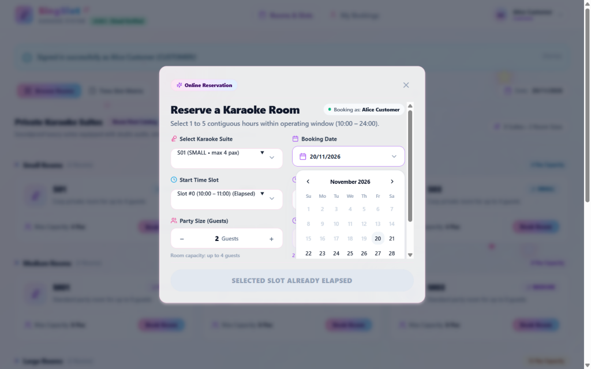
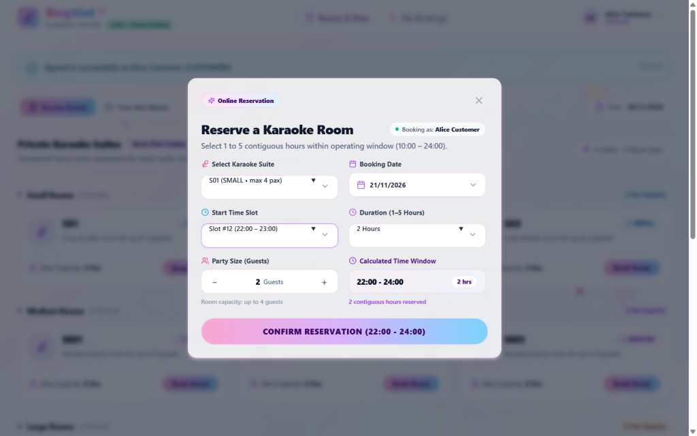
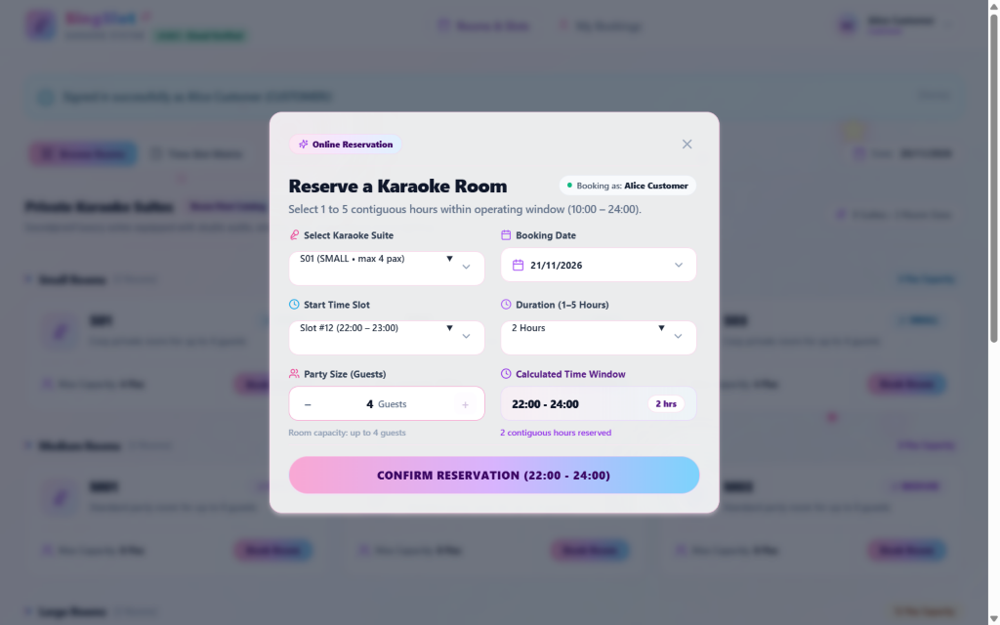
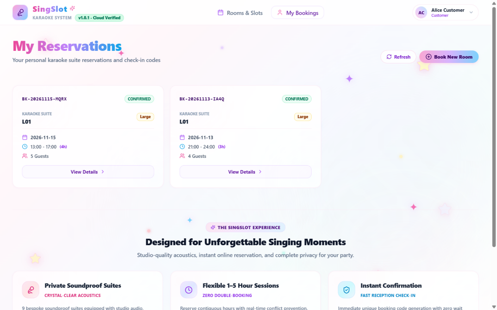
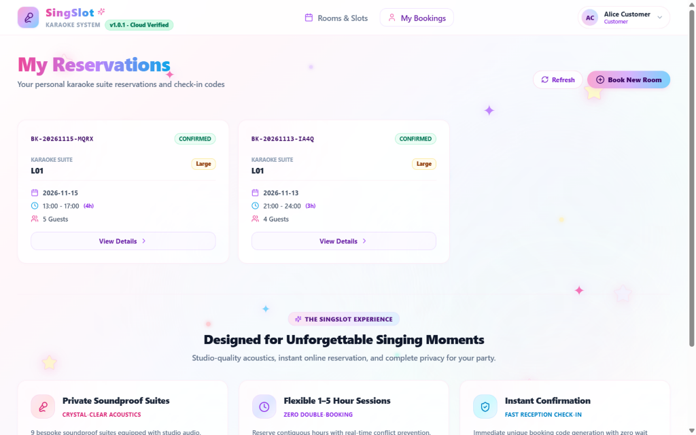
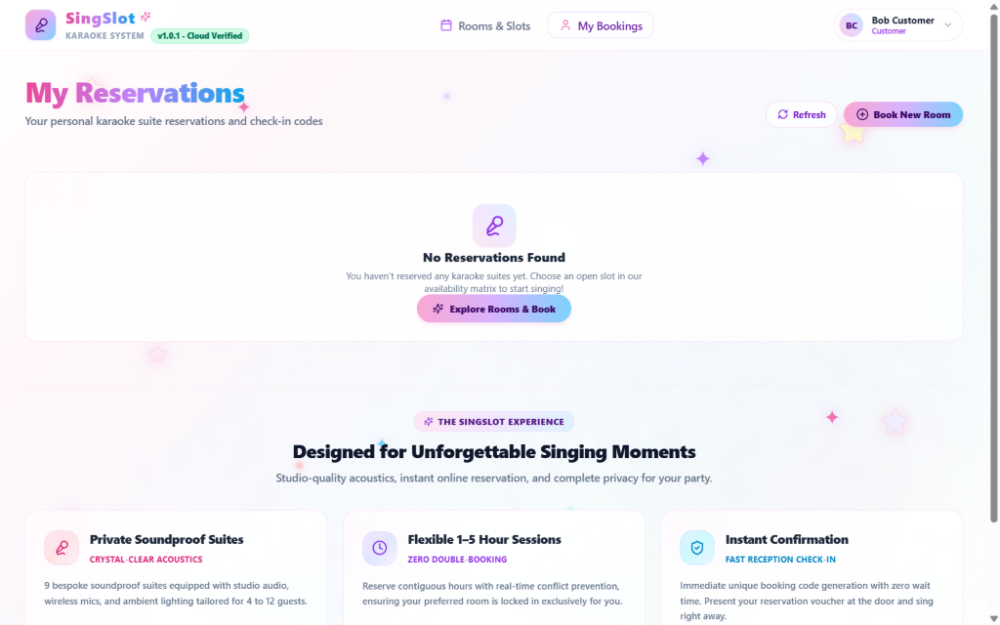

# Lab 6 Part B: Independent User Acceptance Testing (UAT) Execution Report

> **Course:** CPE 334 Introduction to Software Engineering in the Age of AI Agents (Semester 1/2026)  
> **Deliverable:** Lab 6 — Independent User Acceptance Testing and Defect Management (Part B: 25 Points)  
> **Independent UAT Team:** Whatsss Team (`@Pilaiwan3492` & `@Apichaya251400`)  
> **Partner Product Team Evaluated:** SingSlot Team (`@Phenwatsa` & `@lephirada`)  
> **Tracking Issues:** Whatsss Repo [`#40` (`ISSUE 18` — `UAT-03` & `UAT-04` by `@Apichaya251400`)](https://github.com/Pilaiwan3492/Whatsss-PMandELS/issues/40) & [`#38` (`ISSUE 17` — `UAT-01`, `UAT-02` & `UAT-05` by `@Pilaiwan3492`)](https://github.com/Pilaiwan3492/Whatsss-PMandELS/issues/38) | Partner Repo [`Phenwatsa/singslot-karaoke#35`](https://github.com/Phenwatsa/singslot-karaoke/issues/35)

---

## 1. Partner System & Tested Release Identification

| Attribute | Partner Specification / Observed Live Value |
| :--- | :--- |
| **Partner Application Name** | **SingSlot — Karaoke Room Reservation & Management System** |
| **Live Deployed URL** | [https://singslot-4o7kwmd5ma-as.a.run.app](https://singslot-4o7kwmd5ma-as.a.run.app) |
| **Partner GitHub Repository** | [https://github.com/Phenwatsa/singslot-karaoke](https://github.com/Phenwatsa/singslot-karaoke) |
| **Partner Handoff & UAT Plan (`Part A`)** | [`docs/labs/lab-06/handoff.md`](https://github.com/Phenwatsa/singslot-karaoke/blob/sprint-1-staging/docs/labs/lab-06/handoff.md) & [`docs/labs/lab-06/uat-cases.md`](https://github.com/Phenwatsa/singslot-karaoke/blob/sprint-1-staging/docs/labs/lab-06/uat-cases.md) |
| **GCP Project & Cloud Run Service** | `cpe334-singslot-en-038-p1` / `singslot` (`asia-southeast1`, Cloud SQL PostgreSQL 16: `singslot-pg`) |
| **Deployed Cloud Run Revision** | `singslot-00004-6mv` (`100%` traffic) |
| **Deployed Release Commit SHA (`main`)** | `aa5f109b97c157a143a7a9a94cd58dc02998467e` |
| **Sprint 1 Baseline Git Tag** | `v0.1.0-sprint1` |
| **UI Release Name / Badge** | `v1.0.1 - Cloud Verified` |
| **Server Operating Timezone** | `Asia/Bangkok` (UTC+7) |

---

## 2. Test Account Directory & Joint Team Assignment

In compliance with course security rules (**R-12**), secret passwords provided privately by the SingSlot Product Team are excluded from this repository and PDF report.

| Account Label | Login Email | Role | Assigned UAT Cases | Assigned UAT Tester |
| :--- | :--- | :---: | :--- | :--- |
| **Customer 1 (Alice Customer)** | `customer1@singslot.local` | `CUSTOMER` | `UAT-01`, `UAT-03`, `UAT-04`, `UAT-05` | `@Pilaiwan3492` (`UAT-01`, `UAT-05`) / `@Apichaya251400` (`UAT-03`, `UAT-04`) |
| **Customer 2 (Bob Customer)** | `customer2@singslot.local` | `CUSTOMER` | `UAT-02`, `UAT-03`, `UAT-04` | `@Pilaiwan3492` (`UAT-02`) / `@Apichaya251400` (`UAT-03`, `UAT-04`) |
| **Staff (Cashier Staff)** | `staff@singslot.local` | `STAFF` | `UAT-05` | `@Pilaiwan3492` (`UAT-05`) |

---

## 3. Master UAT Execution Summary Table (`UAT-01` – `UAT-05`)

| Case ID | Category | Requirement & Contract Ref | Tested By | Date & Time (ICT) | Tested Version / Revision | Status | Actual Result Summary |
| :---: | :--- | :--- | :---: | :---: | :---: | :---: | :--- |
| **UAT-01** | Normal Domain Journey | `FR-01`..`04`, `BR-01`, `AC-04a`, `TEST-04a` | `@Pilaiwan3492` | *(To be recorded in Issue #38)* | `singslot-00004-6mv` (`aa5f109`) | *(Pending Issue #38)* | *(To be completed by `@Pilaiwan3492` under Issue #38)* |
| **UAT-02** | Business-Rule / Conflict | `FR-03`, `FR-04`, `BR-01`, `BR-02`, `AC-04b`, `TEST-04b` | `@Pilaiwan3492` | *(To be recorded in Issue #38)* | `singslot-00004-6mv` (`aa5f109`) | *(Pending Issue #38)* | *(To be completed by `@Pilaiwan3492` under Issue #38)* |
| **UAT-03** | Boundary Validation | `FR-03`, `FR-04`, `BR-01`, `BR-03`..`05`, `AC-04c/d`, `TEST-04c/d` | `@Apichaya251400` | `2026-11-20 20:51` | `singslot-00004-6mv` (`aa5f109`) | **`PASS`** | UI calendar popover disabled past dates (`1–19 Nov 2026` prior to `2026-11-20`), disabled `3/4/5 Hours (Exceeds 24:00)` when `Slot #12 (22:00–23:00)` was selected, and disabled `+` at `4 Guests` on Room `S01` (`id: c0a3cee2-57c6-4bbb-bf71-ae17c03061b9`). Direct `POST /api/bookings/online` boundary calls returned `HTTP 400 Bad Request` with exact error codes `CANNOT_BOOK_PAST_SLOT`, `EXCEEDS_CAPACITY`, and `INVALID_DURATION`. |
| **UAT-04** | Forbidden Role / Ownership | `FR-01`, `FR-05`, `FR-06`, `BR-07`, `BR-08`, `AC-01c`, `AC-05`, `AC-05b`, `TEST-01c`, `TEST-05`, `TEST-05b` | `@Apichaya251400` | `2026-11-20 20:53` | `singslot-00004-6mv` (`aa5f109`) | **`PASS`** | Customer 1 (`customer1@singslot.local`) owned 2 confirmed bookings (`BK-20261115-MQRX`, UUID `718f0d84-2657-4a87-ad6a-487235d6a1f6` and `BK-20261113-IA4Q`, UUID `a27fc388-3d1b-48ac-a272-f4cfcbdd494b`) and opened `Reservation Detail` (`HTTP 200 OK`). Customer 2 (`customer2@singslot.local`) saw `0` bookings (`No Reservations Found`), had no `Master Schedule` button in the navbar, received `HTTP 403 FORBIDDEN` (`"You are not authorized to view this booking."`) on `GET /api/bookings/718f0d84-2657-4a87-ad6a-487235d6a1f6`, and received `HTTP 403 FORBIDDEN` (`"Access denied: insufficient permissions"`) on `GET /api/bookings/master?date=2026-11-21`. |
| **UAT-05** | State / History / Persistence | `FR-05`, `FR-06`, `BR-07`, `BR-08`, `AC-05`, `AC-06`, `TEST-05`, `TEST-06` | `@Pilaiwan3492` | *(To be recorded in Issue #38)* | `singslot-00004-6mv` (`aa5f109`) | *(Pending Issue #38)* | *(To be completed by `@Pilaiwan3492` under Issue #38)* |

---

## 4. Detailed UAT Case Execution Logs

### 🧪 Case `UAT-01`: End-to-End Online Booking Flow (Normal Domain Journey)
* **Assigned Tester:** `@Pilaiwan3492` (Tracked under [Issue #38](https://github.com/Pilaiwan3492/Whatsss-PMandELS/issues/38))
* **Status:** *(To be populated by `@Pilaiwan3492` in Issue #38 PR)*

---

### 🧪 Case `UAT-02`: Slot Overlap Conflict Prevention (Business-Rule / Conflict)
* **Assigned Tester:** `@Pilaiwan3492` (Tracked under [Issue #38](https://github.com/Pilaiwan3492/Whatsss-PMandELS/issues/38))
* **Status:** *(To be populated by `@Pilaiwan3492` in Issue #38 PR)*

---

### 🧪 Case `UAT-03`: Past Slot, Operating Window & Capacity Boundary Enforcement (Boundary Validation)
* **Case ID:** `UAT-03`
* **Category:** Business-Rule / Boundary Validation Case
* **Requirement & Contract Traceability:** `FR-03` (Availability Query), `FR-04` (Online Booking), `BR-01` (Contiguous Slot Rule: 1–5 hours), `BR-03` (Operating Hours Boundary: 10:00–24:00, slots `0..13`), `BR-04` (Past Slot Rejection in `Asia/Bangkok`), `BR-05` (Capacity Limit), `AC-04c`, `AC-04d`, `TEST-04c`, `TEST-04d`
* **Tester:** `@Apichaya251400`
* **Date & Time Executed:** `2026-11-20 20:50–20:54 ICT (UTC+7)`
* **Tested App Version / Commit:** `https://singslot-4o7kwmd5ma-as.a.run.app` | Cloud Run Revision: `singslot-00004-6mv` | Commit SHA: `aa5f109b97c157a143a7a9a94cd58dc02998467e` | Git Tag: `v0.1.0-sprint1` | UI Badge: `v1.0.1 - Cloud Verified`
* **Roles & Accounts Used:**
  - `customer1@singslot.local` (`Alice Customer`, Role: `CUSTOMER`) for interactive UI boundary verification.
  - `customer2@singslot.local` (`Bob Customer`, Role: `CUSTOMER`) Bearer token for direct HTTP API boundary verification against `POST /api/bookings/online`.

#### Actual Input Values Used
1. **Target Room:** Room `S01` (`id: "c0a3cee2-57c6-4bbb-bf71-ae17c03061b9"`, `SMALL • max 4 pax`, `capacity: 4`)
2. **Boundary Input A (Operating Window & Max Duration — `BR-01`, `BR-03`):**
   - Selected `Booking Date = 21/11/2026` (`2026-11-21`, Tomorrow relative to `2026-11-20` `Asia/Bangkok` server date).
   - Inspected `Duration (1–5 Hours)` dropdown at `Start Time Slot = Slot #0 (10:00 - 11:00)` and after switching `Start Time Slot` to `Slot #12 (22:00 - 23:00)`.
   - Direct API payloads sent to `POST /api/bookings/online`:
     - Max Duration Overflow (`> 5 hours`): `{ "roomId": "c0a3cee2-57c6-4bbb-bf71-ae17c03061b9", "bookingDate": "2026-11-21", "startSlot": 0, "durationHours": 6, "partySize": 2 }`
     - Operating Window Overflow (`startSlot: 12, durationHours: 3` -> end slot `14 > 13`): `{ "roomId": "c0a3cee2-57c6-4bbb-bf71-ae17c03061b9", "bookingDate": "2026-11-21", "startSlot": 12, "durationHours": 3, "partySize": 2 }`
3. **Boundary Input B (Capacity Limit — `BR-05`, `AC-04d`, `TEST-04d`):**
   - In Room `S01` (`max 4 pax`) booking modal, clicked `+` on `Party Size (Guests)` from `2` -> `3` -> `4`.
   - Direct API payload sent to `POST /api/bookings/online`:
     - `{ "roomId": "c0a3cee2-57c6-4bbb-bf71-ae17c03061b9", "bookingDate": "2026-11-21", "startSlot": 0, "durationHours": 1, "partySize": 6 }`
4. **Boundary Input C (Past Date Rejection — `BR-04`, `AC-04c`, `TEST-04c`):**
   - Opened `Booking Date` calendar popover (`November 2026`) on `2026-11-20` (`Asia/Bangkok`) and inspected dates `1` through `19`.
   - Direct API payload sent to `POST /api/bookings/online`:
     - `{ "roomId": "c0a3cee2-57c6-4bbb-bf71-ae17c03061b9", "bookingDate": "2026-11-19", "startSlot": 0, "durationHours": 1, "partySize": 2 }`

#### Actual Results Observed
1. **UI Past Date Picker Guard (`BR-04` — Evidence `EV-UAT03-01`):**
   - Clicking the `Booking Date` field inside the `Reserve a Karaoke Room` modal for Room `S01` opened the `November 2026` calendar popover.
   - All calendar day buttons prior to the current `Asia/Bangkok` date (`1` through `19` November 2026) had `disabled` attributes and muted styling, preventing user selection of past dates. Dates from `20` November 2026 onward were enabled.
2. **UI Operating Window & Max Duration Boundary (`BR-01`, `BR-03` — Evidence `EV-UAT03-02`):**
   - At `Start Time Slot = Slot #0 (10:00 - 11:00)`, the `Duration (1–5 Hours)` dropdown offered `1 Hour`, `2 Hours`, `3 Hours`, `4 Hours`, and `5 Hours` (no option `> 5` hours existed in the UI).
   - After changing `Start Time Slot` to `Slot #12 (22:00 - 23:00)`, the dropdown dynamically updated and disabled options that would extend beyond `24:00` (`Slot #13`):
     - `1 Hour` (`value="1"`, `disabled=false`)
     - `2 Hours` (`value="2"`, `disabled=false`) — `Calculated Time Window` displayed `22:00 - 24:00` (`2 hrs`, `2 contiguous hours reserved`)
     - `3 Hours (Exceeds 24:00)` (`value="3"`, `disabled=true`)
     - `4 Hours (Exceeds 24:00)` (`value="4"`, `disabled=true`)
     - `5 Hours (Exceeds 24:00)` (`value="5"`, `disabled=true`)
3. **UI Capacity Limit Stepper (`BR-05`, `AC-04d` — Evidence `EV-UAT03-03`):**
   - On Room `S01` (`SMALL • max 4 pax`), clicking the `+` button incremented `Party Size (Guests)` from default `2` up to `4`. At `4`, the `+` button became disabled (`disabled=true`) with helper text `Room capacity: up to 4 guests`.
4. **Direct Backend API Boundary Enforcement (`POST /api/bookings/online`):**
   - **API Check 1 — Past Date (`bookingDate: "2026-11-19"`, `BR-04` / `AC-04c` / `TEST-04c`):** Returned **`HTTP 400 Bad Request`**:
     ```json
     {
       "success": false,
       "error": {
         "code": "CANNOT_BOOK_PAST_SLOT",
         "message": "Cannot book slots in the past or currently in progress."
       }
     }
     ```
   - **API Check 2 — Over-Capacity (`partySize: 6` on Room `S01` with `capacity: 4`, `BR-05` / `AC-04d` / `TEST-04d`):** Returned **`HTTP 400 Bad Request`**:
     ```json
     {
       "success": false,
       "error": {
         "code": "EXCEEDS_CAPACITY",
         "message": "Party size (6) exceeds room capacity (4)."
       }
     }
     ```
   - **API Check 3 — Exceed Max Duration (`durationHours: 6`, `BR-01`):** Returned **`HTTP 400 Bad Request`**:
     ```json
     {
       "success": false,
       "error": {
         "code": "INVALID_DURATION",
         "message": "Duration must be between 1 and 5 contiguous hours and end within operating hours (10:00 - 24:00, slots 0..13)."
       }
     }
     ```
   - **API Check 4 — Operating Window Overflow (`startSlot: 12, durationHours: 3`, `BR-03`):** Returned **`HTTP 400 Bad Request`** with `code: "INVALID_DURATION"` and the same message. Zero bookings or slot records were created on `2026-11-21`.
5. **Non-Blocking UI Wording Observation:**
   - `uat-cases.md` Step 1 refers to the room card button as `"Book This Suite"`, whereas the live UI renders the button label as **`"Book Room"`**. This is a minor documentation wording difference and not a functional defect.

* **Execution Status:** **`PASS`**

#### Screenshot Evidence for `UAT-03`
- **`EV-UAT03-01` — Past Date Picker Guard (`BR-04`):**  
  
- **`EV-UAT03-02` — Operating Window Boundary at `Slot #12 (22:00 – 23:00)` (`BR-01`, `BR-03`):**  
  
- **`EV-UAT03-03` — Capacity Limit Stepper on Room `S01` (`max 4 pax`) (`BR-05`, `AC-04d`):**  
  

---

### 🧪 Case `UAT-04`: Customer Data Isolation & Staff Authorization Boundary (Forbidden Role / Ownership)
* **Case ID:** `UAT-04`
* **Category:** Forbidden Role / Cross-Customer Ownership Case
* **Requirement & Contract Traceability:** `FR-01` (Authentication & RBAC), `FR-05` (My Bookings & Booking Detail Ownership), `FR-06` (Staff Master Schedule Restriction), `BR-07` (Data Isolation & Ownership), `BR-08` (Staff Operational Boundary), `AC-01c`, `AC-05`, `AC-05b`, `TEST-01c`, `TEST-05`, `TEST-05b`
* **Tester:** `@Apichaya251400`
* **Date & Time Executed:** `2026-11-20 20:51–20:55 ICT (UTC+7)`
* **Tested App Version / Commit:** `https://singslot-4o7kwmd5ma-as.a.run.app` | Cloud Run Revision: `singslot-00004-6mv` | Commit SHA: `aa5f109b97c157a143a7a9a94cd58dc02998467e` | Git Tag: `v0.1.0-sprint1` | UI Badge: `v1.0.1 - Cloud Verified`
* **Roles & Accounts Used:**
  - **Customer 1 (Owner):** `customer1@singslot.local` (`Alice Customer`, Role: `CUSTOMER`)
  - **Customer 2 (Unauthorized Customer):** `customer2@singslot.local` (`Bob Customer`, Role: `CUSTOMER`)

#### Actual Input Values Used
1. **Customer 1 Confirmed Reservation Records (from `GET /api/bookings/my` as `customer1@singslot.local`):**
   - Primary target booking ID tested: **`718f0d84-2657-4a87-ad6a-487235d6a1f6`** (`bookingCode: "BK-20261115-MQRX"`, Room `L01`, `bookingDate: "2026-11-15"`, `13:00 - 17:00`, `4h`, `partySize: 5`, `status: "CONFIRMED"`)
   - Second existing booking owned by Customer 1: **`a27fc388-3d1b-48ac-a272-f4cfcbdd494b`** (`bookingCode: "BK-20261113-IA4Q"`, Room `L01`, `bookingDate: "2026-11-13"`, `21:00 - 24:00`, `3h`, `partySize: 4`, `status: "CONFIRMED"`)
2. **Unauthorized Requests Executed as Customer 2 (`customer2@singslot.local`):**
   - UI Navigation to `My Bookings` (`GET /api/bookings/my`) and inspection of top navigation bar items.
   - Direct Cross-Customer Ownership API Request: `GET /api/bookings/718f0d84-2657-4a87-ad6a-487235d6a1f6` with Customer 2's JWT Bearer token.
   - Direct Staff Master Schedule API Request: `GET /api/bookings/master?date=2026-11-21` with Customer 2's JWT Bearer token.

#### Actual Results Observed
1. **Customer 1 (`Alice Customer`) Owner Verification (`FR-05` — Evidence `EV-UAT04-01` & `EV-UAT04-02`):**
   - Logged in as `customer1@singslot.local` and opened `My Bookings`. `GET /api/bookings/my` returned `HTTP 200 OK` with `count: 2` (`BK-20261115-MQRX` and `BK-20261113-IA4Q`).
   - Clicking `View Details` on `BK-20261115-MQRX` sent `GET /api/bookings/718f0d84-2657-4a87-ad6a-487235d6a1f6`, which returned **`HTTP 200 OK`** and opened the `Reservation Detail` modal displaying `BK-20261115-MQRX`, `CONFIRMED`, `L01 VIP Luxury`, `2026-11-15`, `13:00 - 17:00 (4 Hours Total)`, `Alice Customer`, `5 Guests`, `0898765432`, and `Reserved Hourly Slots` (`Slot #3`, `Slot #4`, `Slot #5`, `Slot #6`).
2. **Customer 2 (`Bob Customer`) UI List Isolation & Navbar Role Guard (`FR-05`, `AC-05`, `TEST-05` — Evidence `EV-UAT04-03`):**
   - Logged out of `Alice Customer` and signed in as `customer2@singslot.local` (`BC Bob Customer • Customer`).
   - Inspected the top navigation bar: only **`Rooms & Slots`** and **`My Bookings`** were rendered; the Staff-only **`Master Schedule`** button was not rendered for `CUSTOMER`.
   - Clicked **`My Bookings`**: `GET /api/bookings/my` returned `HTTP 200 OK` with `{"success":true,"count":0,"bookings":[]}`.
   - The UI rendered **`No Reservations Found`** (`"You haven't reserved any karaoke suites yet. Browse our rooms and real-time availability matrix to book your session!"`). None of Customer 1's reservations (`BK-20261115-MQRX` or `BK-20261113-IA4Q`) appeared in Customer 2's list.
3. **Direct Cross-Customer Ownership API Guard (`GET /api/bookings/:id` — `BR-07`, `AC-05b`, `TEST-05b`):**
   - Executing `GET /api/bookings/718f0d84-2657-4a87-ad6a-487235d6a1f6` with Customer 2's Bearer token returned **`HTTP 403 Forbidden`** with exact JSON body:
     ```json
     {
       "success": false,
       "error": {
         "code": "FORBIDDEN",
         "message": "You are not authorized to view this booking."
       }
     }
     ```
   - Zero customer PII, phone numbers, booking codes, or slot allocations from Customer 1 were leaked.
4. **Direct Staff Master Schedule API Guard (`GET /api/bookings/master` — `BR-08`, `AC-01c`, `TEST-01c`):**
   - Executing `GET /api/bookings/master?date=2026-11-21` with Customer 2's Bearer token returned **`HTTP 403 Forbidden`** with exact JSON body:
     ```json
     {
       "success": false,
       "error": {
         "code": "FORBIDDEN",
         "message": "Access denied: insufficient permissions"
       }
     }
     ```
   - *(Observation: HTTP status `403` and `error.code: "FORBIDDEN"` match `BR-08`, `AC-01c`, and `contracts.md`. The middleware returns `error.message: "Access denied: insufficient permissions"` rather than the illustrative string `"Staff privileges required."` shown in `uat-cases.md`.)*

* **Execution Status:** **`PASS`**

#### Screenshot Evidence for `UAT-04`
- **`EV-UAT04-01` — Customer 1 (`Alice Customer`) "My Bookings" View (`GET /api/bookings/my` -> `count: 2`):**  
  
- **`EV-UAT04-02` — Customer 1 Owner Access to `Reservation Detail` (`GET /api/bookings/718f0d84-2657-4a87-ad6a-487235d6a1f6` -> `200 OK`):**  
  
- **`EV-UAT04-03` — Customer 2 (`Bob Customer`) Isolated "My Bookings" View (`count: 0`, No `Master Schedule` button in navbar):**  
  

---

### 🧪 Case `UAT-05`: State Synchronization & History Persistence (State / History / Persistence)
* **Assigned Tester:** `@Pilaiwan3492` (Tracked under [Issue #38](https://github.com/Pilaiwan3492/Whatsss-PMandELS/issues/38))
* **Status:** *(To be populated by `@Pilaiwan3492` in Issue #38 PR)*
