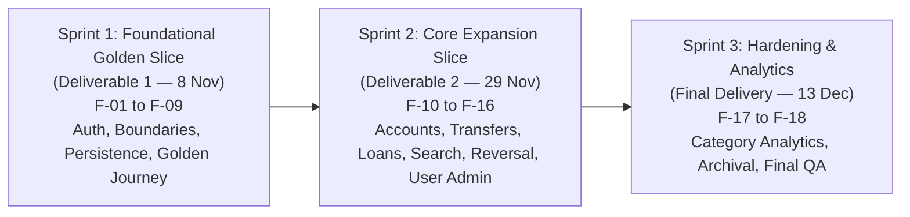
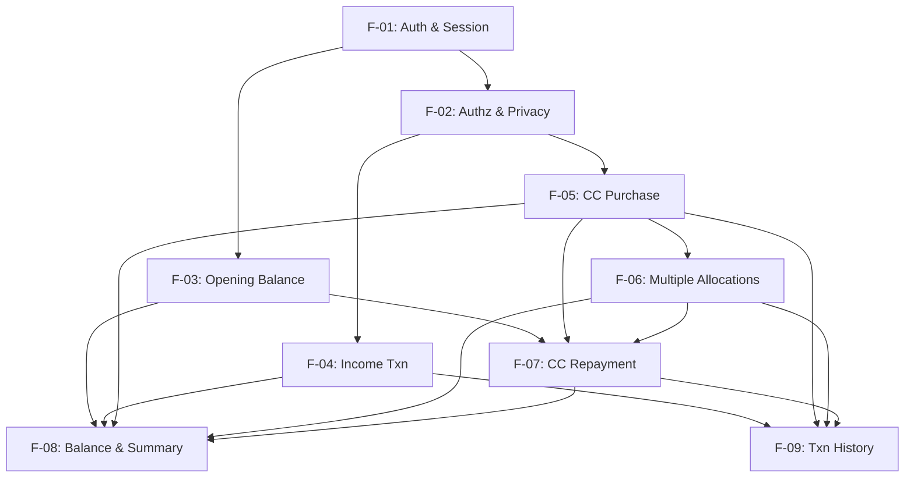

# Three-Sprint Product Roadmap & Engineering Plan (Part D)
## Project: Whatsss — Personal Finance Management Web Application

> **Course:** CPE 334 Introduction to Software Engineering in the Age of AI Agents  
> **Semester:** 1/2026 | **Project Theme:** Theme 7 — Personal Money and Expense Logging System  
> **Deliverable:** Project Deliverable 1 (Part D: Three-Sprint Plan)  
> **Status:** Authoritative Baseline (Frozen)  

---

## 1. Executive Summary & Sprint Allocation Strategy

The Whatsss development lifecycle is organized into three balanced sprints designed to deliver incremental value, preserve architectural discipline, and ensure rigorous test coverage:

---

## 2. Sprint Breakdown and Objectives

### 2.1 Sprint 1: Foundational Golden Slice (Deliverable 1 Checkpoint: 8 Nov 2026)
* **Strategic Goal:** Establish the engineering baseline, authentication/authorization infrastructure, relational data schema, and a complete, tested vertical slice implementing the Theme 7 Golden Domain Journey.
* **Included Features:**
  * `F-01`: Authentication & Session (Login, Logout, Current User via HttpOnly Cookie)
  * `F-02`: Authorization & Privacy (Tenancy Isolation & Admin Barrier)
  * `F-03`: Opening Balance (Bank Account starting balance lifecycle and locking rule)
  * `F-04`: Income Transaction (Salary received into bank with date)
  * `F-05`: Credit Card Purchase (Credit charge with date)
  * `F-06`: Multiple Allocations (Dining and Grocery splits with sum validation)
  * `F-07`: Credit Card Repayment (Repay CC from Bank; no double-counting)
  * `F-08`: Balance & Summary (Bank balance, CC debt, Income/Expense totals)
  * `F-09`: Transaction History (Ledger persistence & history retrieval)
* **Justification for Sprint 1 Scope:** Demonstrates complete end-to-end integration through UI, API, and PostgreSQL database, enforcing core business rules (`BR-01` to `BR-10`) without introducing non-essential administrative or secondary feature overhead.
* **Checkpoint Deliverable:** Working release on `main`, reproducible local setup, passing automated test suite, and Deliverable 1 PDF report.

---

### 2.2 Sprint 2: Core Expansion Slice (Deliverable 2 Checkpoint: 29 Nov 2026)
* **Strategic Goal:** Expand the application to support full user self-management of accounts, internal fund movements, informal lending/borrowing workflows, transaction utilities, and platform user directory governance.
* **Included Features:**
  * `F-10`: Account Creation & Management (User custom accounts across 5 types)
  * `F-11`: Internal Cash Transfer (Fund movement between bank/cash accounts)
  * `F-12`: Loan Given & Recovery (Peer lending tracking)
  * `F-13`: General Loan Taken & Repayment (General debt tracking)
  * `F-14`: Favorite & Duplicate Transactions (Transaction shortcuts)
  * `F-15`: Transaction Search & Filtering (Date and category query engine)
  * `F-16`: Transaction Corrections (Adjusting past entries safely)
  * Platform user directory inspection (`FR-03`) and user access status governance (`FR-04`).
* **Checkpoint Deliverable:** Integrated release candidate on `main`, continuous regression test suite, and Deliverable 2 PDF report.

---

### 2.3 Sprint 3: Completion, Hardening & Analytics (Final Delivery Checkpoint: 13 Dec 2026)
* **Strategic Goal:** Harden the application against defects, complete analytical reporting, verify cross-team UAT resolutions, and prepare release documentation and demonstration video.
* **Included Features:**
  * `F-17`: Category Spending Summaries & Reports (In-depth distribution analytics)
  * `F-18`: Audited Correction History & Archival (Soft-delete lifecycle)
* **Checkpoint Deliverable:** Fully verified release on `main`, passing regression suite, under-10-minute presentation video, and Final PDF report.

---

## 3. Inter-Feature Dependency Mapping

