# Project Deliverable 2 Report — Sprint 2 & Sprint 3 Release Candidate (`v0.2.0-sprint2-rc`)
## Project: Whatsss — Personal Finance Management Web Application

> **Course:** CPE 334 Introduction to Software Engineering in the Age of AI Agents  
> **Semester:** 1/2026 | **Project Theme:** Theme 7 — Personal Money and Expense Logging System  
> **Deliverable:** Project Deliverable 2 (Parts C, D, and E)  
> **Release Candidate Tag:** `v0.2.0-sprint2-rc`  
> **Release Commit (`main`):** `467eb4c8a7155c822fbaab8e1b4a52f9d5ae3ade` ([PR #67](https://github.com/Pilaiwan3492/Whatsss-PMandELS/pull/67))  
> **Live Cloud Run URL:** https://whatsss-sipqw4logq-as.a.run.app  
> **Release & Deployment:** Completed (`467eb4c8a7155c822fbaab8e1b4a52f9d5ae3ade`, `v0.2.0-sprint2-rc`, [Main CI #315](https://github.com/Pilaiwan3492/Whatsss-PMandELS/actions/runs/46151836583), [Deploy demo #13](https://github.com/Pilaiwan3492/Whatsss-PMandELS/actions/runs/46151836654))  
> **Automated Regression:** Passed (`548/548` backend incl. Live PG16, `104/104` frontend)  
> **Unauthenticated Smoke Checks:** Passed (`SMOKE-LIVE-01`..`04`)  
> **Authenticated Live Demonstrations:** Completed (`DEMO-LIVE-01`..`03`, 16 live Cloud Run screenshots + [`deliverable-2-report.pdf`](./deliverable-2-report.pdf))  
> **Overall Part E:** **Completed**

---

## 1. Release & Deployment Evidence

| Artifact / Check | Identifier / Reference | Verified Result |
|---|---|---|
| **Release SHA (`main`)** | `467eb4c8a7155c822fbaab8e1b4a52f9d5ae3ade` | Merged from `staging-lab5` via [PR #67](https://github.com/Pilaiwan3492/Whatsss-PMandELS/pull/67) |
| **Release Tag** | `v0.2.0-sprint2-rc` | Points to `467eb4c8a7155c822fbaab8e1b4a52f9d5ae3ade` |
| **Main CI (`main`)** | [Run #315 (`46151836583`)](https://github.com/Pilaiwan3492/Whatsss-PMandELS/actions/runs/46151836583) | `completed / success` (`Backend Test & Build`, `Frontend Test & Build`, `Docker Container Build & Probe`, `Secret & Credential Leak Scan`, `Check C-03 Clean Clone Build & Run Verification`) |
| **GCP Cloud Run Deploy** | [Deploy demo #13 (`46151836654`)](https://github.com/Pilaiwan3492/Whatsss-PMandELS/actions/runs/46151836654) | `completed / success` (`Test & Build Gate / test-and-docker`, `Deploy to Cloud Run`); revision `whatsss-00030-k42` (`100%` traffic), image digest `sha256:76c621119e92ab98a2eaa557c76176f5ae9f1653326ddd7237b13cbed5eadcea` |
| **WP-12 Implementation SHA** | `e23416a9fd3f3d8326e6e60799fb2bed9e3c5c2f` | Verified by [Main CI #311 (`46109538015`)](https://github.com/Pilaiwan3492/Whatsss-PMandELS/actions/runs/46109538015) & [C-01 #165 (`46109542107`)](https://github.com/Pilaiwan3492/Whatsss-PMandELS/actions/runs/46109542107) |
| **WP-12 Teammate Review (PR #66)** | `@Apichaya251400` | `APPROVED` at `2026-11-28T13:38:40Z` on `de71fd0c62bb9e465cade68649fd16592e2362a0` |
| **Part E Doc PR (#68) Prior Heads** | `9fdae8be` / `188be001` / `7b8b08fc` / `a81eda84` | Verified by [C-01 #169 (`46152652691`)](https://github.com/Pilaiwan3492/Whatsss-PMandELS/actions/runs/46152652691), [C-01 #170 (`46153460161`)](https://github.com/Pilaiwan3492/Whatsss-PMandELS/actions/runs/46153460161), [C-01 #171 (`46155022864`)](https://github.com/Pilaiwan3492/Whatsss-PMandELS/actions/runs/46155022864), and [C-01 #172 (`46158573822`)](https://github.com/Pilaiwan3492/Whatsss-PMandELS/actions/runs/46158573822) (`completed / success`) |

---

## 2. Sprint 1–3 Feature Completion & Issue #60 Acceptance Criteria

### 2.1 Work Package Completion Summary

| Work Package | Features | Requirements | Status on `main` (`467eb4c`) |
|---|---|---|---|
| **Sprint 1 + Lab 6/7** | `F-01`..`F-09` | `FR-01`..`FR-11`, `BR-01`..`BR-10` | **Accepted, Deployed & Live-Verified (`v0.1.0-sprint1` + `9054b45` + `DEMO-LIVE-01`)** |
| **`WP-08`** ([#56](https://github.com/Pilaiwan3492/Whatsss-PMandELS/issues/56) / [PR #62](https://github.com/Pilaiwan3492/Whatsss-PMandELS/pull/62)) | `F-10` Custom Accounts, `F-11` Cash Transfers | `FR-12`, `FR-13`, `BR-02` | **Released, Deployed & Live-Verified (`467eb4c`, `03-f10`, `04-f11`)** |
| **`WP-09`** ([#57](https://github.com/Pilaiwan3492/Whatsss-PMandELS/issues/57) / [PR #65](https://github.com/Pilaiwan3492/Whatsss-PMandELS/pull/65)) | `F-12` Loan Given/Recovery, `F-13` General Loan Taken/Repayment | `FR-14`, `FR-15`, `BR-08` | **Released, Deployed & Live-Verified (`467eb4c`, `05-f12`, `05b-f13`)** |
| **`WP-10`** ([#58](https://github.com/Pilaiwan3492/Whatsss-PMandELS/issues/58) / [PR #63](https://github.com/Pilaiwan3492/Whatsss-PMandELS/pull/63)) | `F-14` Favorite & Duplicate, `F-15` Search & Filtering | `FR-16`, `FR-17`, `FR-18` | **Released, Deployed & Live-Verified (`467eb4c`, `06-f14-f15`, `06b-f14`, `07-f16`)** |
| **`WP-11`** ([#59](https://github.com/Pilaiwan3492/Whatsss-PMandELS/issues/59) / [PR #64](https://github.com/Pilaiwan3492/Whatsss-PMandELS/pull/64)) | `F-16` Transaction Corrections, `F-19` Admin User Governance | `FR-03`, `FR-04`, `FR-19`, `BR-10` | **Released, Deployed & Live-Verified (`467eb4c`, `07-f16`, `11a-br10`, `11b-f19`)** |
| **`WP-12`** ([#60](https://github.com/Pilaiwan3492/Whatsss-PMandELS/issues/60) / [PR #66](https://github.com/Pilaiwan3492/Whatsss-PMandELS/pull/66), [PR #67](https://github.com/Pilaiwan3492/Whatsss-PMandELS/pull/67)) | `F-17` Category Spending Reports, `F-18` Audit History & Archival | `FR-20`, `FR-21`, `BR-01`, `BR-02`, `BR-08`, `BR-10` | **Released, Deployed & Live-Verified (`467eb4c`, `08-f18`, `09-f17`, `10a-f18`, `10b-f18`)** |

### 2.2 Issue #60 Acceptance Criteria Verification

| Issue #60 Acceptance Criterion | Automated Verification | Live Cloud Run Verification (`467eb4c`) | Status |
|---|---|---|---|
| **`AC-17-1`..`AC-17-3` (`F-17` Category Spending Reports):** Period-filtered category totals, `ROUND_HALF_UP` percentages, exclusion of transfers/repayments/loans (`BR-02`, `BR-08`), tenant & admin guards (`BR-01`, `BR-10`) | `reports-categories.test.ts` (`5/5`), `db-reports-audit-archive.test.ts` (`5/5`), `DashboardPage.test.tsx` (`11/11`) | `DEMO-LIVE-02g` (`09-f17-category-report.png`: `2026-11-17` filter `Grocery 66.67%`, `Dining 33.33%`, `Total: 3,000.00 THB`, excluding loans/transfers/repayments); `SMOKE-LIVE-03` (`401` unauth) | **Verified** |
| **`AC-18-1`..`AC-18-3` (`F-18` Audit History & Archival):** Reverse-chronological (`sequence_number DESC`) immutable audit snapshots, `422 ACCOUNT_BALANCE_NON_ZERO`, zero-balance archival & `422 ACCOUNT_ARCHIVED` guards | `audit-history.test.ts` (`4/4`), `account-archive.test.ts` (`2/2`), `archived-guards.test.ts` (`1/1`), `db-reports-audit-archive.test.ts` (`5/5`), `AccountListPage.test.tsx` (`13/13`), `TransactionHistoryPage.test.tsx` (`16/16`) | `DEMO-LIVE-02f` (`08-f18-audit-history-modal.png`), `DEMO-LIVE-02h` (`10a-f18-archive-nonzero-error.png`), `DEMO-LIVE-02i` (`10b-f18-archive-success.png`); `SMOKE-LIVE-04` (`401` unauth) | **Verified** |
| **Full Regression & Live Cloud Run Release:** `0` failed in CI backend + frontend; live Cloud Run matches tagged `main` commit (`v0.2.0-sprint2-rc`) | [Main CI #315](https://github.com/Pilaiwan3492/Whatsss-PMandELS/actions/runs/46151836583) (`548/548` backend, `104/104` frontend); [Deploy #13](https://github.com/Pilaiwan3492/Whatsss-PMandELS/actions/runs/46151836654) | `SMOKE-LIVE-02` (`/api/health` `commitSha: 467eb4c8a7155c822fbaab8e1b4a52f9d5ae3ade`), `DEMO-LIVE-01`..`03` (16 screenshots + PDF) | **Verified** |

---

## 3. Automated Regression & Test Evidence

- **Backend Full Suite (CI Live PostgreSQL 16 `whatsss_test` + Mock API + Unit):**
  - **42/42 test files, 548/548 tests passed (`0` failed, `0` skipped in CI)** and TypeScript build (`tsc`) clean on Release SHA `467eb4c8a7155c822fbaab8e1b4a52f9d5ae3ade` ([Main CI #315](https://github.com/Pilaiwan3492/Whatsss-PMandELS/actions/runs/46151836583)).
  - Local non-DB execution (`npx vitest run --pool=forks`): `42/42` files, `458 passed | 90 skipped (548)` (90 Live PG16 tests skipped locally when PostgreSQL is offline, executed in CI above).
- **Frontend Full Suite:**
  - **10/10 test files, 104/104 tests passed (`0` failed, `0` skipped)** and production build (`tsc -b && vite build`) clean on `e23416a9fd3f3d8326e6e60799fb2bed9e3c5c2f` and `467eb4c8a7155c822fbaab8e1b4a52f9d5ae3ade` ([Main CI #315](https://github.com/Pilaiwan3492/Whatsss-PMandELS/actions/runs/46151836583)).
- **Key `WP-12` (`F-17` & `F-18`) Regression Coverage:**
  - `reports-categories.test.ts` (`5/5`, incl. `TEST-REP-CAT-01B` `ROUND_HALF_UP` half-cent tie)
  - `audit-history.test.ts` (`4/4`, incl. `TEST-AUDIT-01B` `BIGINT` decimal-string precision above `Number.MAX_SAFE_INTEGER`)
  - `account-archive.test.ts` (`2/2`), `archived-guards.test.ts` (`1/1`)
  - `db-reports-audit-archive.test.ts` (`5/5` in CI Live PG16, incl. `TEST-AUDIT-03` `loan-recovery`/`loan-repayment` archived guards, `TEST-AUDIT-05` DB immutability triggers, and `TEST-FAV-CORR-CONC-01`)
  - `DashboardPage.test.tsx` (`11/11`, incl. `TEST-UI-REP-CAT-01`..`04`), `AccountListPage.test.tsx` (`13/13`), `TransactionHistoryPage.test.tsx` (`16/16`, incl. `TEST-UI-AUDIT-01`..`04`)

---

## 4. Live Cloud Run Smoke Checks & Authenticated Demonstrations (`https://whatsss-sipqw4logq-as.a.run.app`)

### 4.1 Unauthenticated Smoke Checks (`SMOKE-LIVE-01`..`04`)

| Evidence ID | Date / Time (UTC) | Action / Command | Expected Result | Actual Result | Endpoint / UI | Release SHA |
|---|---|---|---|---|---|---|
| `SMOKE-LIVE-01` | `2026-11-28T13:59:58Z` | `Invoke-WebRequest -Uri "https://whatsss-sipqw4logq-as.a.run.app/"` | `HTTP 200 OK`, `text/html`, SPA `
` | `HTTP 200 OK`, `text/html; charset=UTF-8`, `hasRootDiv=True` | `GET /` (SPA) | `467eb4c8a7155c822fbaab8e1b4a52f9d5ae3ade` |
| `SMOKE-LIVE-02` | `2026-11-28T13:59:49Z` | `Invoke-RestMethod -Uri "https://whatsss-sipqw4logq-as.a.run.app/api/health"` | `HTTP 200 OK`, `status: "ok"`, matching `commitSha` | `HTTP 200 OK`, `{"status":"ok","commitSha":"467eb4c8a7155c822fbaab8e1b4a52f9d5ae3ade"}` | `GET /api/health` | `467eb4c8a7155c822fbaab8e1b4a52f9d5ae3ade` |
| `SMOKE-LIVE-03` | `2026-11-28T14:00:14Z` | `curl.exe -s "https://whatsss-sipqw4logq-as.a.run.app/api/reports/categories"` (unauth) | `HTTP 401 UNAUTHORIZED` (`Authentication required`) | `HTTP 401`, `{"success":false,"error":{"code":"UNAUTHORIZED","message":"Authentication required"}}` | `GET /api/reports/categories` | `467eb4c8a7155c822fbaab8e1b4a52f9d5ae3ade` |
| `SMOKE-LIVE-04` | `2026-11-28T14:00:14Z` | `curl.exe -s "https://whatsss-sipqw4logq-as.a.run.app/api/transactions/00000000-0000-0000-0000-000000000000/audit-history"` (unauth) | `HTTP 401 UNAUTHORIZED` (`Authentication required`) | `HTTP 401`, `{"success":false,"error":{"code":"UNAUTHORIZED","message":"Authentication required"}}` | `GET /api/transactions/:id/audit-history` | `467eb4c8a7155c822fbaab8e1b4a52f9d5ae3ade` |

### 4.2 Sprint 1 Golden Journey Live Continuity (`DEMO-LIVE-01`, `TEST-E2E-01`)

| Golden Journey Step | Sprint 1 Feature / AC | Live Action Executed on Cloud Run (`467eb4c`) | Verified Live Result & Evidence |
|---|---|---|---|
| **Step 1: Auth, Opening Balance & Accounts (`F-01`..`F-03`)** | `AC-01-1..3`, `AC-03-1..4` | Login as `user_demo` (`USER`), verify `Checking Bank` (`Opening: 10,000.00`, locked) and `Visa Credit Card` (`CREDIT_CARD`) | Authenticated session active; accounts & balances persisted (`01-login-dashboard.jpg`, `02-golden-journey-flow.png`) |
| **Step 2: Income Recording & Continuity (`F-04`)** | `AC-04-1..2`, `BR-03` | Verify persisted `Salary` inflows (`45,000.00` total income) and duplicate `20,000.00` `Salary` inflow in History | Income inflows reflected in Dashboard & History (`01-login-dashboard.jpg`, `06b-f14-duplicate-transaction.png`) |
| **Step 3: Credit Card Split Purchase (`F-05`, `F-06`)** | `AC-05-1..3`, `AC-06-1..3`, `BR-04`..`BR-06` | Record `300.00 THB` purchase on `Visa Credit Card` split across `Dining: 100.00 THB` + `Grocery: 200.00 THB` | Split expense committed (`- 300.00 THB`) with 2 allocation lines matching total (`02b-golden-split-purchase.png`) |
| **Step 4: CC Partial Repayment & Summary/History (`F-07`..`F-09`)** | `AC-07-1..10`, `AC-08-1`, `AC-09-1..2`, `BR-07 v1.1`, `BR-08` | Pay `600.00 THB` toward `Visa Credit Card` (`5,400 -> 4,800`), verify Dashboard totals & History persistence | `Checking Bank` `-600.00` (`48,400 -> 47,800`), `Visa Credit Card` `4,800.00`; expense totals exclude repayment (`02-golden-journey-flow.png`, `09-f17-category-report.png`) |

### 4.3 Authenticated Live Demonstrations (`DEMO-LIVE-01`..`03`, 16 Screenshots)

| Evidence ID | Date / Time (UTC) | Action | Expected Result | Actual Result | Endpoint / UI | Release SHA |
|---|---|---|---|---|---|---|
| `DEMO-LIVE-01a` | `2026-11-28T14:40:31Z` | Login as `user_demo` (`USER`) and view Dashboard | 4 summary cards, Expense Category Breakdown, and Recent Transactions render | Rendered `48,400.00` cash, `5,400.00` debt, `45,000.00` income, `12,000.00` expense | `/dashboard` (`01-login-dashboard.jpg`) | `467eb4c8a7155c822fbaab8e1b4a52f9d5ae3ade` |
| `DEMO-LIVE-01b` | `2026-11-28T14:43:01Z` | Execute partial credit card repayment (`600.00 THB`) | Checking Bank reduces `48,400 -> 47,800`; Visa Credit Card reduces `5,400 -> 4,800` | Checking Bank `47,800.00`, Visa Credit Card `4,800.00` (`BR-07 v1.1`) | `/accounts` (`02-golden-journey-flow.png`) | `467eb4c8a7155c822fbaab8e1b4a52f9d5ae3ade` |
| `DEMO-LIVE-01c` | `2026-11-28T15:25:50Z` | Record Credit Card Split Purchase (`300.00 THB`: `Dining 100.00` + `Grocery 200.00`) | Split allocation transaction recorded on `Visa Credit Card` | `- 300.00 THB` with `Dining: 100.00 THB` & `Grocery: 200.00 THB` (`F-05`, `F-06`) | `/transactions` (`02b-golden-split-purchase.png`) | `467eb4c8a7155c822fbaab8e1b4a52f9d5ae3ade` |
| `DEMO-LIVE-02a` | `2026-11-28T14:44:35Z` | Create custom `CASH` account `Saving Bank` (`F-10`) | New `CASH` account card appears with `0.00` balance | `Saving Bank` (`CASH`, `$0.00`) created and displayed | `/accounts` (`03-f10-accounts-create.png`) | `467eb4c8a7155c822fbaab8e1b4a52f9d5ae3ade` |
| `DEMO-LIVE-02b` | `2026-11-28T14:46:59Z` | Transfer `1,000.00` from `Checking Bank` to `Saving Bank` (`F-11`) | `Checking Bank` `-1,000` (`46,800.00`), `Saving Bank` `+1,000` (`1,000.00`) | Both balances updated atomically; income/expense unchanged (`BR-02`) | `/accounts` (`04-f11-internal-transfer.png`) | `467eb4c8a7155c822fbaab8e1b4a52f9d5ae3ade` |
| `DEMO-LIVE-02c` | `2026-11-28T14:51:04Z` | Create `Friend Loan` (`LOAN_GIVEN`) and disburse `500.00` (`F-12`) | `Friend Loan` shows `Current Receivable: 500.00` | `Friend Loan` (`LOAN_GIVEN`, `500.00`), `Opening balance locked` | `/accounts` (`05-f12-loans.png`) | `467eb4c8a7155c822fbaab8e1b4a52f9d5ae3ade` |
| `DEMO-LIVE-02d` | `2026-11-28T15:21:46Z` | Create `Personal Loan` (`LOAN_TAKEN`, `GENERAL_LOAN`) and borrow `1,000.00` (`F-13`) | `Personal Loan` shows `GENERAL_LOAN` badge and `Current Debt: 1,000.00` | `Personal Loan` (`LOAN_TAKEN`, `GENERAL_LOAN`, `$1,000.00`, `Repay Loan`) | `/accounts` (`05b-f13-general-loan.png`) | `467eb4c8a7155c822fbaab8e1b4a52f9d5ae3ade` |
| `DEMO-LIVE-02e` | `2026-11-28T14:53:00Z` | Filter History with `q=Test` and `Category=Dining` (`F-15`) | Only matching split-expense rows returned | 2 matching rows displayed (`Lab7 Post-Deploy Test Expense`, `Unbalanced Split Test`) | `/transactions` (`06-f14-f15-history-search.png`) | `467eb4c8a7155c822fbaab8e1b4a52f9d5ae3ade` |
| `DEMO-LIVE-02f` | `2026-11-28T15:23:45Z` | Duplicate `Income` transaction (`20,000.00 THB`) (`F-14`) | New transaction created with success alert and `is_favorite = false` | Alert: `Transaction duplicated successfully.`; new unstarred row added | `/transactions` (`06b-f14-duplicate-transaction.png`) | `467eb4c8a7155c822fbaab8e1b4a52f9d5ae3ade` |
| `DEMO-LIVE-02g` | `2026-11-28T14:56:41Z` | Toggle Favorite ★ (`F-14`) and open `Correct Transaction` modal (`F-16`) | Favorite star active; modal edits split lines (`400.00` + `100.00` = `500.00`) | Favorite toggled (`Favorites Only (1)`) and split allocation lines edited | `/transactions` (`07-f16-correction-modal.jpg`) | `467eb4c8a7155c822fbaab8e1b4a52f9d5ae3ade` |
| `DEMO-LIVE-02h` | `2026-11-28T14:57:35Z` | Save correction and inspect `Audit History` modal (`F-18`) | Displays `CORRECTED` entry with Previous & New Snapshot allocations | `Previous Snapshot` (`Friend Loan: 500.00`) vs `New Snapshot` (`400.00` + `Saving Bank: 100.00 — TestF16`) | `/transactions` (`08-f18-audit-history-modal.png`) | `467eb4c8a7155c822fbaab8e1b4a52f9d5ae3ade` |
| `DEMO-LIVE-02i` | `2026-11-28T14:59:23Z` | Apply date filter `2026-11-17`..`2026-11-17` on Dashboard (`F-17`) | Shows only period expenses (`Grocery 66.67%`, `Dining 33.33%`), excluding transfers/loans | `Total: 3,000.00 THB`, `Grocery (1 txns) 2,000.00 THB (66.67%)`, `Dining (1 txns) 1,000.00 THB (33.33%)` | `/dashboard` (`09-f17-category-report.png`) | `467eb4c8a7155c822fbaab8e1b4a52f9d5ae3ade` |
| `DEMO-LIVE-02j` | `2026-11-28T15:00:54Z` | Attempt `Archive` on non-zero `Saving Bank` (`1100.00`) (`F-18`) | Rejected with `ACCOUNT_BALANCE_NON_ZERO` error | Alert: `Cannot archive an account with a non-zero balance (1100.00).` | `/accounts` (`10a-f18-archive-nonzero-error.png`) | `467eb4c8a7155c822fbaab8e1b4a52f9d5ae3ade` |
| `DEMO-LIVE-02k` | `2026-11-28T15:02:43Z` | Transfer `1100.00` back so `Saving Bank` is `0.00` and click `Archive` (`F-18`) | Account archived with `Archived` badge and `Unarchive` button | `Saving Bank` (`$0.00`) shows `Archived` badge and `Unarchive` button | `/accounts` (`10b-f18-archive-success.png`) | `467eb4c8a7155c822fbaab8e1b4a52f9d5ae3ade` |
| `DEMO-LIVE-02l` | `2026-11-28T15:06:06Z` | Login as `admin` (`ADMIN`) and observe user financial route guard (`BR-10`) | Blocked with `403 Access Forbidden (BR-10)` | `/access-denied` (`Access Forbidden (403)`, `Security Policy (BR-10)`) | `/access-denied` (`11a-br10-admin-403.png`) | `467eb4c8a7155c822fbaab8e1b4a52f9d5ae3ade` |
| `DEMO-LIVE-02m` | `2026-11-28T15:07:25Z` | Open `User Directory` as `admin` (`F-19`) | Displays non-financial user directory with self-disable blocked | `admin` (`Disable` disabled), `user_demo` (`Active`), `user_other` (`Active`) | `/admin/users` (`11b-f19-admin-directory.png`) | `467eb4c8a7155c822fbaab8e1b4a52f9d5ae3ade` |
| `DEMO-LIVE-03` | `2026-11-28T15:28:00Z` | Bundle all 16 live screenshots and export Deliverable 2 PDF | Self-contained `deliverable-2-report.pdf` generated | Generated [`deliverable-2-report.pdf`](./deliverable-2-report.pdf) | `docs/sprints/sprint-2/` | `467eb4c8a7155c822fbaab8e1b4a52f9d5ae3ade` |

---

## 5. Captured Cloud Run Evidence Gallery (16 Screenshots)

### `DEMO-LIVE-01`: Sprint 1 Golden Journey Continuity
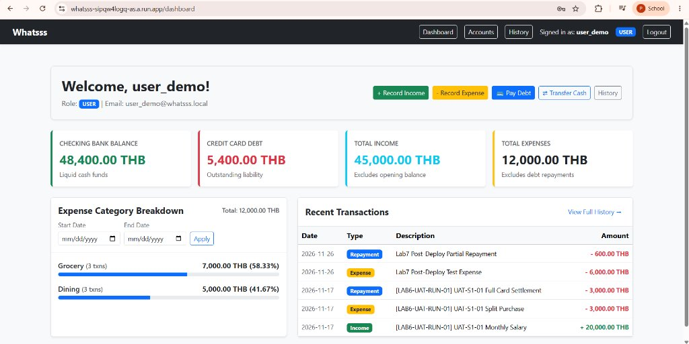
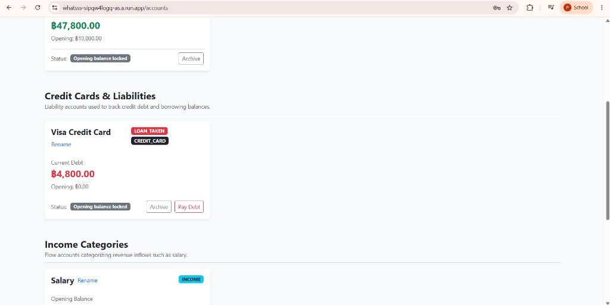
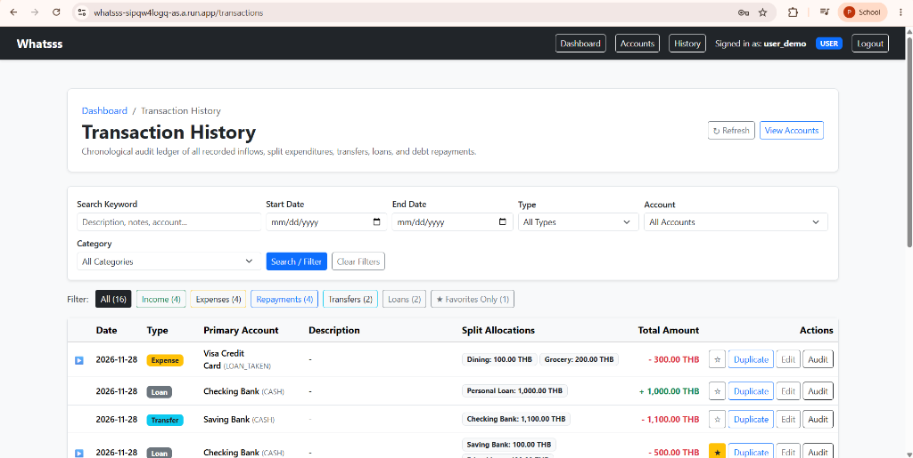

### `DEMO-LIVE-02`: Sprint 2 & Sprint 3 Features (`F-10`..`F-19`, `BR-10`)
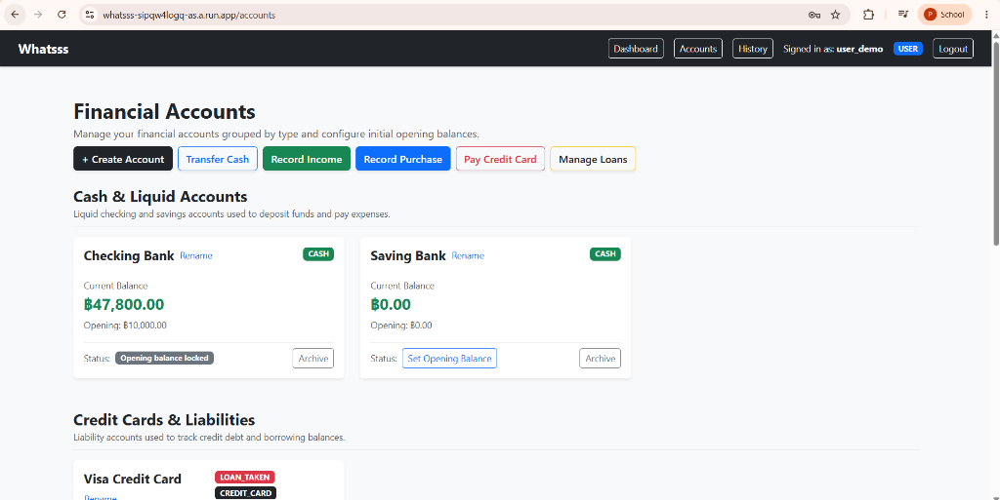
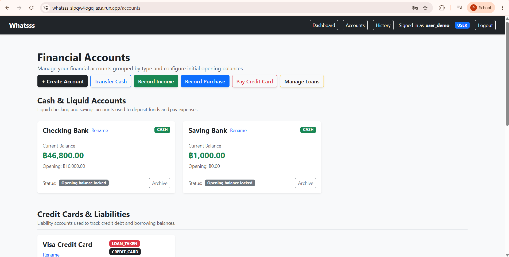
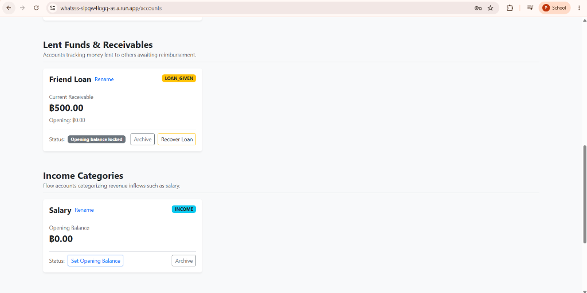
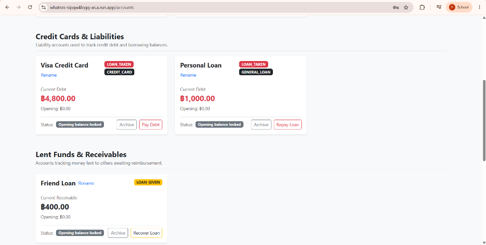
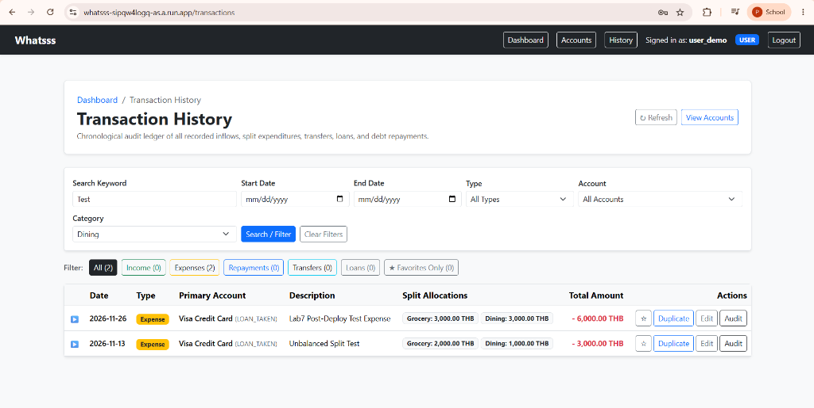
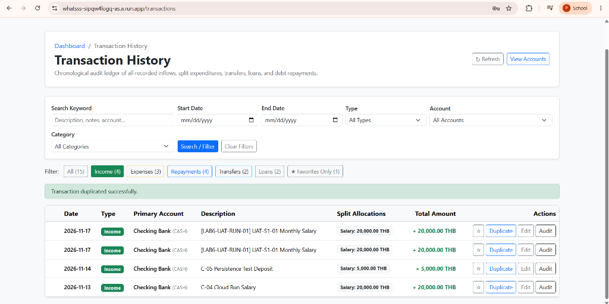
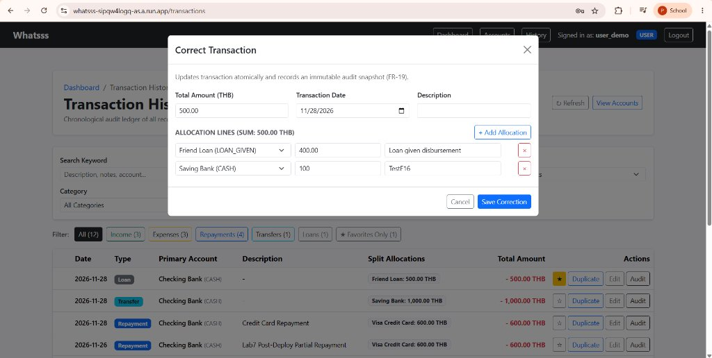
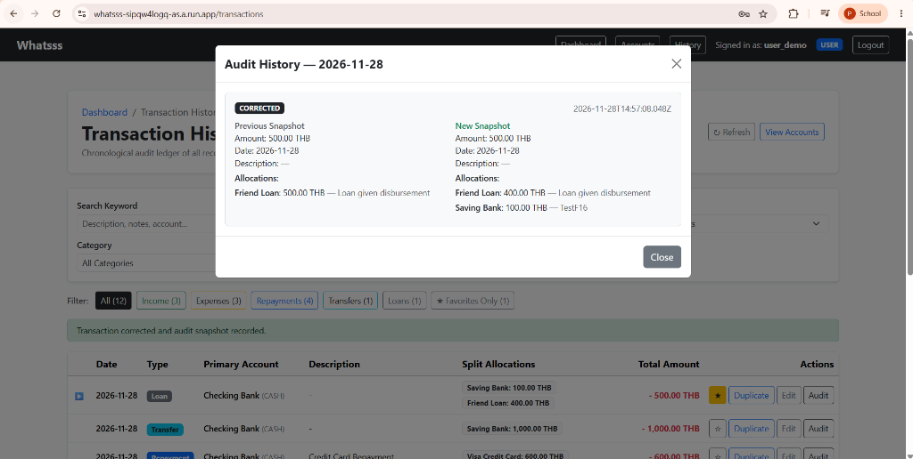
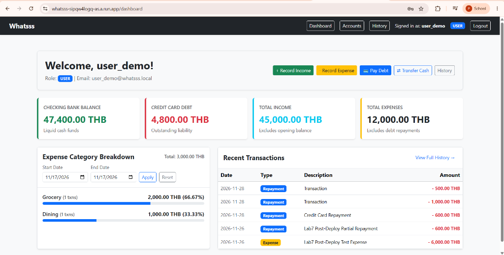
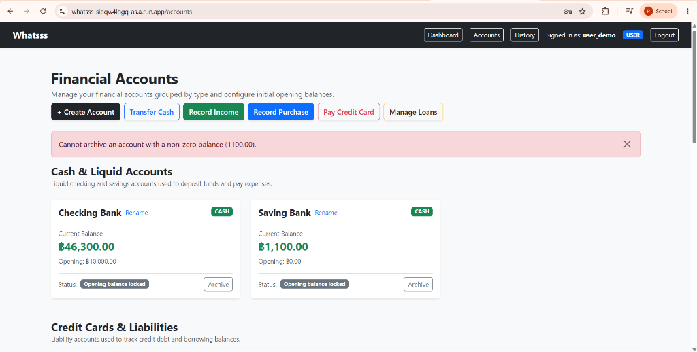
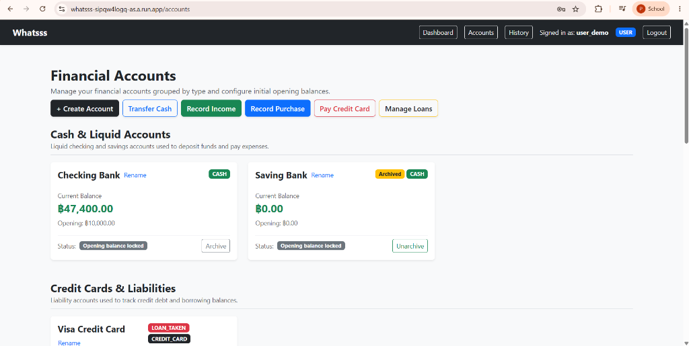
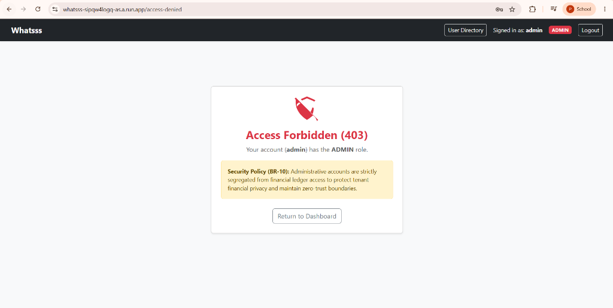
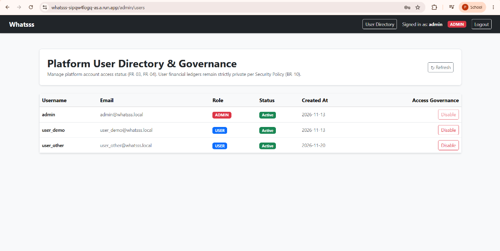

---

## 6. Companion Part D & Verification Artifacts
- [SRS (`docs/srs.md`)](../../srs.md)
- [Feature Inventory (`docs/features.md`)](../../features.md)
- [System SDS (`docs/system-sds.md`)](../../system-sds.md)
- [Requirements Traceability Matrix (`docs/traceability.md`)](../../traceability.md)
- [Sprint 2 & 3 Test Specification (`docs/sprints/sprint-2/test-specification.md`)](./test-specification.md)
- [Sprint 3 Feature Contracts (`docs/sprints/sprint-3/feature-contracts.md`)](../sprint-3/feature-contracts.md)
- [Deliverable 2 PDF (`docs/sprints/sprint-2/deliverable-2-report.pdf`)](./deliverable-2-report.pdf)
